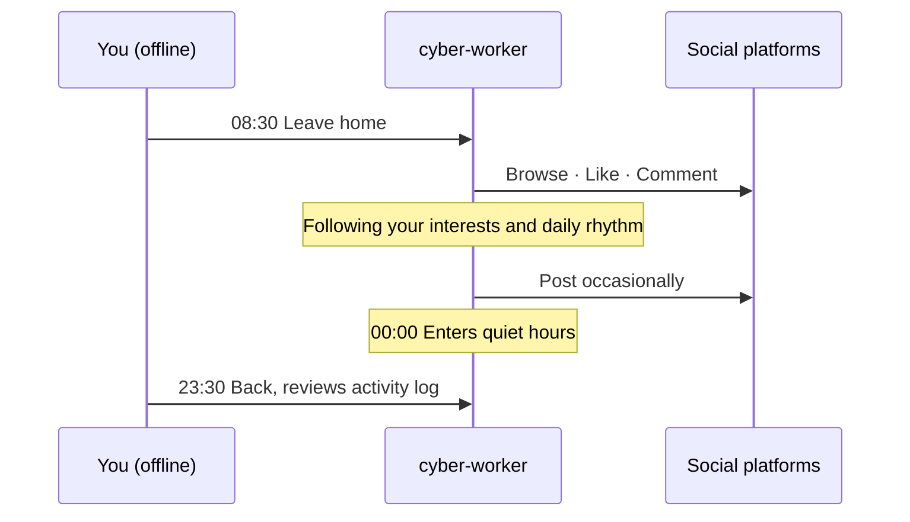
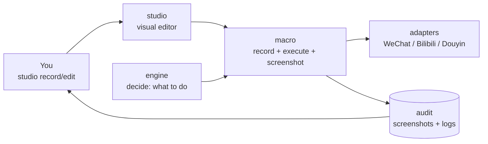

<div align="center">

# 🤖 cyber-worker

**Send another version of yourself to work in the digital world.**

It browses, likes, comments and posts across WeChat, Douyin, Bilibili, Weibo, X and Instagram — at your pace, in your voice. A digital twin that keeps living online while you're away.

**English** · [简体中文](README.zh-CN.md)

[](LICENSE)
[](https://github.com/joshua1688/cyber-worker/stargazers)

[Why this exists](#-why-this-exists) · [What is this](#-what-is-this) · [Features](#-features) · [Quick start](#-quick-start) · [Persona](#-persona) · [Roadmap](#-roadmap) · [FAQ](#-faq)

</div>

---

## 🌱 Why this exists

I spend more and more time on social platforms, yet leave fewer and fewer real traces. Liking, commenting, posting — the small actions that make up an "online presence" — are being diluted by algorithms and endless feeds.

If a twin could keep that presence alive on my behalf — in *my* way, not at machine speed — then when I go offline, the "me" online doesn't disappear.

**cyber-worker** is the result of that idea.

## 📖 What is this

**cyber-worker** is your digital twin.

It is not a crawler scraping pages. It is not a script farming engagement. It imitates **you**: how you browse, what you like, how you phrase a comment, how often you post. When you're offline, it stays online in your way, clocking in for you.

> **You live your life. It lives your presence.**



## 💡 Why not just a script

The value of a digital twin isn't how much it does — it's how much **what it does looks like what you'd do**. The timing of a like, the tone of a comment, matters far more than the volume of actions.

| Typical automation script | 🤖 cyber-worker |
| :--- | :--- |
| Scrape, farm, run tasks | Simulate a real person living online |
| Fixed intervals, mechanical | Human irregularity: pauses, skips, fatigue |
| Templated responses | Reproduces **your** voice and word choices |
| Goal: hit a metric | Goal: look like you |

> **What it does NOT do:** bulk registration, engagement farming, marketing spam, opinion manipulation, CAPTCHA bypass. If that's what you need, this isn't the project for you.

## ✨ Features

| Capability | Description |
| :--- | :--- |
| 👀 **Browsing** | Consumes your feed with your interest weights and dwell-time habits, not uniform scrolling |
| ❤️ **Liking** | Decides from your historical preferences, with human-level uncertainty (not everything gets a like) |
| 💬 **Commenting** | Replies in your voice, controlling length, tone, and emoji frequency |
| 📝 **Posting** | Publishes occasionally, following your active hours and posting frequency — irregular but consistent |
| 🌙 **Rhythm simulation** | Has active and quiet hours. No late-night posts. Weekend behavior shifts |

## 🌐 Supported platforms

<div align="center">

| WeChat | Douyin | Bilibili | Weibo | X | Instagram |
| :---: | :---: | :---: | :---: | :---: | :---: |
| Moments ✅ | Video feed ✅ | Feed ✅ | Home ⬜ | Timeline ⬜ | Feed ⬜ |

</div>

> The platform layer is plugin-based. Adding a platform means implementing a shared behavior interface (docs in progress).

## 🏗️ How it works



1. **studio** — Visual editor where users record, edit, preview, and run macros
2. **engine** — Decision layer: decides "what to do now" based on persona and timing
3. **macro** — Execution layer: handles "how to do it" — recording, clicking, screenshots, audit logs
4. **adapters** — Platform layer: binds macro's capabilities to WeChat / Bilibili / Douyin
5. **audit** — Saves one screenshot + log per action; review by suspicion level afterward

## 🔧 Tech stack

| Layer | Choice | Purpose |
| :--- | :--- | :--- |
| Language | Python 3.11+ | Entire project |
| Data models | Pydantic v2 | Step / Script definitions |
| Mouse & keyboard | pynput | Recording + human-like input (underlying CGEvent) |
| Screenshot / window targeting | macOS native | `screencapture` + `osascript` |
| Web service | FastAPI + Uvicorn | studio/server.py |
| Real-time | WebSocket | Live push of steps during recording |
| Image processing | OpenCV | Screenshot diff, template matching |
| OCR | PaddleOCR | Text-button targeting |
| Frontend | Vanilla HTML + JS + Canvas | No framework |

> **All platforms use screen-level macro operations**, including the web versions of Bilibili and Douyin. From the macro's perspective, a browser window and a client window are indistinguishable — both are just pixel regions on screen. Operating a browser via macros means the browser sees real CGEvent input, which is safer than CDP.

## 🚀 Quick start

```bash
# 1. Clone the repo
git clone https://github.com/joshua1688/cyber-worker.git
cd cyber-worker

# 2. Install dependencies
uv sync
# macOS system dependencies (screenshot, window targeting) are built in — no extra install needed

# 3. Set up your persona
cp persona.example.md persona.md
# Edit persona.md to describe yourself

# 4. Configure platform credentials
cp .env.example .env
# Fill in login info / cookies (never commit to repo)

# 5. Launch
cyber-worker studio    # Opens visual editor in browser
```

## 🧪 Development & test environment

| Device | Spec |
| :--- | :--- |
| Mac mini M6 | 16GB · 256GB |

> Other platforms not yet supported (depends on native macOS screenshot and window targeting).

## 🧬 Persona

How much the twin "feels like you" depends on how detailed `persona.md` is. At minimum, cover:

- 🎯 **Interests** — what you read, what you like
- 🗣️ **Voice** — sentence length, catchphrases, punctuation habits, emoji frequency
- ⏰ **Rhythm** — when you browse, when you don't post, weekday vs. weekend differences
- 🚧 **Boundaries** — what you never comment on, what topics you avoid

<details>
<summary><b>📄 Minimal persona.md example</b></summary>

```markdown
# Who I am

## Interests
- Follows: tech, photography, indie games
- Often likes: friends' daily updates, photography
- Not interested in: marketing accounts, giveaways, gossip

## Voice
- Short sentences, occasional "haha"
- Comments are brief, 2–15 characters
- Rarely uses exclamation marks, almost never emoji
- Never starts arguments

## Rhythm
- Active: 08:00–09:00, 12:30–13:30, 21:00–23:30
- Quiet: 00:00–07:00
- Weekend active hours shift ~1 hour later

## Boundaries
- Never comments on: politics, medical topics, others' privacy
- Never posts: negative emotions, unverified information
```

</details>

## 📁 Project structure

```text
cyber-worker/
├── .gitignore                      # Excludes user_data/, .env, persona.md, __pycache__, etc.
├── .env.example                    # Credentials template (cookies / tokens — never commit real values)
├── pyproject.toml                  # Dependency management (uv / poetry)
├── README.md                       # English docs
├── README.zh-CN.md                 # Chinese docs
├── LICENSE                         # MIT
├── persona.example.md              # Persona template (interests, voice, rhythm, boundaries)
├── main.py                         # CLI entry point (advanced users: cyber-worker run xxx)
├── bootstrap.py                    # Single wiring entry point (both CLI and Studio call it; avoids scattered DI)
│
├── engine/                         # ★ Decision layer: decides "what to do"
│   ├── ports/                      # Interface definitions (core of dependency inversion)
│   │   ├── platform.py             # PlatformPort: browse_feed / like / comment / publish
│   │   ├── memory.py               # MemoryStore: behavior memory read/write
│   │   └── clock.py                # Clock: replaceable (fake clock to fast-forward 24h in tests)
│   ├── persona/                    # Persona parsing
│   │   ├── model.py                # Persona data structure (interests, voice, rhythm, boundaries)
│   │   └── parser.py               # persona.md → Persona
│   ├── timing/                     # Human-like time distribution
│   │   └── distribution.py         # Poisson process, active-hour clustering, weekend variance
│   ├── tone/                       # Voice generation
│   │   ├── generator.py            # Pluggable: template / LLM
│   │   └── style_model.py          # Extract personal style from comment history
│   ├── memory/                     # Behavior memory business logic
│   │   └── service.py              # Dedup, coherence, liked/commented records
│   └── decision/                   # Decision policies
│       ├── orchestrator.py         # Main loop: what to do now
│       ├── policy_like.py          # Like policy + skip rate
│       ├── policy_comment.py       # Comment policy
│       └── policy_post.py          # Post policy
│
├── macro/                          # ★ Execution layer: decides "how to do it" (all screen mode)
│   ├── schema.py                   # Step / Script data models (Pydantic)
│   ├── recorder.py                 # Recording engine (pynput mouse/keyboard listener, called by studio)
│   ├── runner.py                   # Execution engine (step-by-step click + post-action screenshot)
│   ├── locator/                    # Targeting
│   │   ├── coord.py                # Coordinate targeting (baseline)
│   │   ├── ocr.py                  # OCR targeting (text buttons)
│   │   └── template.py             # Template matching (icon buttons)
│   ├── act/                        # Human-like operations
│   │   ├── mouse.py                # Bezier trajectory + overshoot + micro-jitter
│   │   ├── keyboard.py             # Lognormal typing intervals + typo correction
│   │   └── scroll.py               # Segmented scroll + inertia + occasional scroll-back
│   ├── screenshot/                 # Screenshot archiving
│   │   ├── storage.py              # Naming, date-based partitioning, 30-day cleanup
│   │   └── anomaly.py              # Single-frame coarse filter (flag suspicious when mismatched)
│   ├── audit/                      # Post-hoc audit (pure logic, no HTTP)
│   │   ├── logger.py               # SQLite action logs (with screenshot path + expected state)
│   │   ├── reviewer.py             # Sort by suspicion, sample
│   │   └── reporter.py             # Daily report, success rate, failure distribution
│   ├── io/                         # System IO
│   │   └── macos.py                # screencapture + pynput + osascript wrappers
│   └── templates/                  # ★ Built-in templates (in git, read-only)
│       ├── manifest.json           # Template index (only lists recorded ones, status: ready)
│       ├── _screenshots/           # Template reference screenshots (product shots, distributed with project)
│       │   └── wechat_moments_1200x900.png
│       ├── wechat/                 # screen mode (coordinate macros, generated by recording)
│       │   ├── moments_browse.yaml         # Open Moments + scroll N screens
│       │   ├── moments_like.yaml           # Browse + like
│       │   └── moments_open_publish.yaml   # Click camera → land on publish page
│       ├── bilibili/               # screen mode (coordinate macros, generated by recording)
│       │   ├── feed_browse.yaml            # Open feed + scroll N screens
│       │   └── feed_like.yaml              # Browse + like
│       ├── douyin/                 # screen mode (coordinate macros, generated by recording)
│       │   ├── feed_browse.yaml            # Open recommendations + scroll N screens
│       │   └── feed_like.yaml              # Browse + like
│       ├── weibo/                  # Future support (empty dir + .gitkeep)
│       ├── x/                      # Future support
│       └── instagram/              # Future support
│
├── adapters/                       # ★ Platform layer: decides "where to do it" (all screen mode)
│   ├── wechat/
│   │   ├── adapter.py              # screen mode, calls macro/runner to execute coordinate macros
│   │   └── pages.yaml              # Page fingerprints (Moments / Publish / Home)
│   ├── bilibili/
│   │   ├── adapter.py              # screen mode, calls macro/runner
│   │   └── pages.yaml              # Page fingerprints (feed / video / home)
│   ├── douyin/
│   │   ├── adapter.py              # screen mode, calls macro/runner
│   │   └── pages.yaml              # Page fingerprints (recommendations / video / home)
│   ├── weibo/                      # Future support (empty dir + .gitkeep)
│   ├── x/                          # Future support
│   └── instagram/                  # Future support
│
├── studio/                         # ★ Visual editor (primary user entry point)
│   ├── server.py                   # Single FastAPI instance (:9999)
│   ├── ws.py                       # WebSocket: real-time push of steps during recording
│   ├── routes/                     # HTTP endpoints
│   │   ├── record.py               # Recording control (start/stop)
│   │   ├── edit.py                 # Step add/remove/modify, drag-and-drop reorder
│   │   ├── preview.py              # Path preview, frame-by-frame playback
│   │   ├── run.py                  # Execution + real-time status push
│   │   ├── templates.py            # Template listing / fork
│   │   └── audit.py                # Audit page (sorted by suspicion)
│   └── static/                     # Frontend (vanilla HTML + JS + Canvas, no framework)
│       ├── index.html              # Three-column layout: script list / canvas / step list
│       ├── audit.html              # Audit replay page (single screenshot + expected state)
│       ├── canvas.js               # Screenshot + step markers + connecting lines
│       ├── editor.js               # Step card drag, parameter panel
│       └── style.css
│
├── ops/                            # Operations scripts
│   ├── setup_macos.sh              # pmset disable sleep, disable screensaver, permission hints
│   ├── check_permissions.py        # Screen recording + accessibility permission check
│   └── watchdog.py                 # WeChat / browser window watchdog (auto-restart on crash)
│
├── tests/                          # Unit tests
│   ├── test_engine.py              # Decision logic (fake adapter + fake clock)
│   ├── test_humanize.py            # Bezier trajectory, lognormal typing
│   ├── test_anomaly.py             # Single-frame coarse filter false-positive/false-negative
│   ├── test_reviewer.py            # Audit sorting logic
│   ├── test_runner.py              # Execution engine
│   └── fixtures/                   # ★ Test fixtures (not part of runtime, test-only)
│       ├── anomaly/                # Four groups of single-frame samples (real screenshots, not synthetic)
│       │   ├── true_positive/      # Actually succeeded + judged success ✅
│       │   ├── false_positive/     # Actually failed + misjudged success ❌ most dangerous
│       │   ├── true_negative/      # Actually failed + judged failure ✅
│       │   └── false_negative/     # Actually succeeded + misjudged failure ❌ wasted retry
│       └── screenshots/            # Single screenshots: page fingerprints / OCR / template matching
│           ├── wechat_moments_feed.png
│           ├── wechat_publish_page.png
│           ├── bilibili_dynamic_feed.png      # Added when Bilibili/Douyin support lands
│           └── douyin_recommend_feed.png      # Added when Bilibili/Douyin support lands
│
├── docs/                           # Design docs
│   ├── adapters.md                 # Platform adapter interface docs
│   ├── macro.md                    # Macro engine + recording + execution
│   ├── audit.md                    # Screenshot archiving + audit
│   └── studio.md                   # UI usage + routes
│
└── user_data/                      # ★ Runtime data (gitignored, not in git)
    ├── scripts/                    # User-recorded/edited macros
    │   ├── manifest.json           # User script index (separate from built-in template index)
    │   └── my_moments_like.yaml    # User-forked or recorded
    ├── screenshots/                # Runtime screenshots (one per action, 30-day cleanup)
    │   └── 2026-10-22/             # Partitioned by date
    │       ├── 091203_s03_like.png          # Like: after action
    │       ├── 092015_s04_scroll.png        # Scroll: after action
    │       └── 093022_s05_publish.png       # Publish: after action
    ├── logs/                       # Runtime logs
    │   ├── runner.log
    │   └── studio.log
    ├── audit.db                    # Action logs (SQLite: screenshot path + expected state + review status)
    └── memory.db                   # Behavior memory (liked / commented / posted history)
```

## 🗺️ Roadmap

| Status | Item |
| :---: | :--- |
| ⬜ | `macro/` minimal loop (record + execute + post-action screenshot) |
| ⬜ | Audit page (sort by suspicion) |
| ⬜ | `studio/` visual editor (record + edit + preview) |
| ⬜ | WeChat Moments adapter (screen-mode validation) |
| ⬜ | Bilibili / Douyin adapters (same pattern) |
| ⬜ | `engine/` persona parsing + decision engine |
| ⬜ | Voice reproduction |
| ⬜ | Behavior memory |
| ⬜ | Human review mode |

> Legend: ⬜ todo · 🚧 in progress · ✅ done

## ❓ FAQ

<details>
<summary><b>How is this different from a crawler or automation script?</b></summary>

Crawlers extract data; scripts complete actions. cyber-worker aims for *behavioral similarity* — timing, tone, frequency and boundaries aligned with one specific person. It will actively skip, pause, or do nothing, because that's what a real person does.

</details>

<details>
<summary><b>Will my account get banned?</b></summary>

Possibly. Every platform has anti-automation controls. The goal of this project is to study *how to behave more like a human*, not *how to bypass detection*. Risks are yours to bear. Start with a test account.

</details>

<details>
<summary><b>Do I need to hand over my password?</b></summary>

Not recommended. Prefer official authorization flows. If cookies are necessary, make sure `.env` is excluded by `.gitignore` and never committed.

</details>

<details>
<summary><b>Can commenting and posting be fully automatic?</b></summary>

Technically yes, but **human review mode** is strongly recommended — the twin drafts, you confirm. A digital twin should never say things you didn't know it would say.

</details>

## 🤝 Contributing

Issues and PRs are welcome! Before submitting:

1. Fork this repository and create a new branch
2. Follow the existing code style
3. Write clear commit messages
4. Open a PR and reference the related issue

## ⚠️ Disclaimer

**Please read this fully before using.**

- This project is for **personal digital-twin research and experimentation**, for learning and exchange only.
- Most platforms' Terms of Service **restrict or prohibit** automated activity. Using this project may lead to rate-limiting or account bans — **at your own risk**.
- Do not use it for engagement farming, marketing, opinion manipulation, bulk registration, or any use that violates platform rules or applicable law.
- Commenting and posting should be used with **human review mode** to prevent the twin from publishing content you were unaware of.
- Respect local laws, others' privacy, and community guidelines.

> **The goal of this project is not to bypass platform defenses — it is to study how to make a digital twin feel more human. Please stay on that side of the line.**

## 📄 License

Released under the [MIT License](LICENSE).

---

<div align="center">

**If this project resonates with you, please give it a ⭐ Star**

</div>