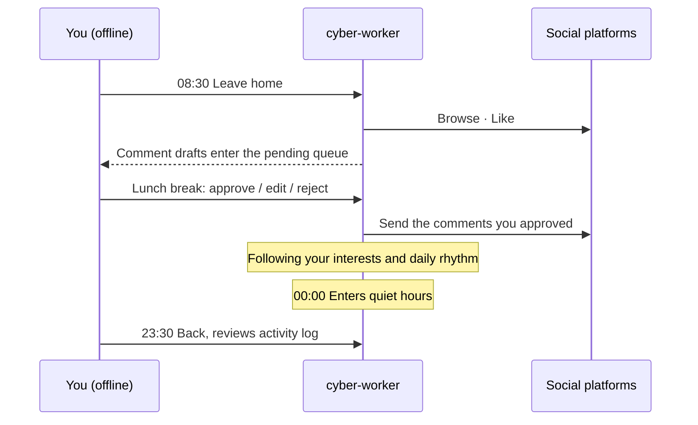
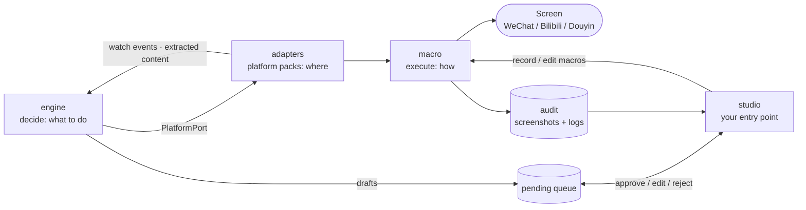
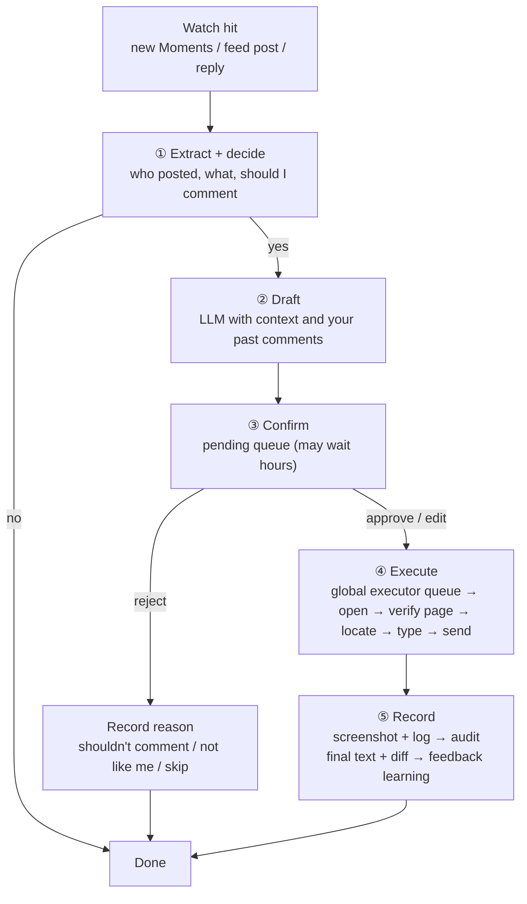

<div align="center">

# 🤖 cyber-worker

**Send another version of yourself to work in the digital world.**

It browses, likes, comments and posts across WeChat, Douyin, Bilibili, Weibo, X and Instagram — at your pace, in your voice. A digital twin that keeps living online while you're away.

**English** · [简体中文](README.zh-CN.md)

[](LICENSE)
[](https://www.python.org/downloads/)

**[🚀 Quick start →](#-quick-start)**

</div>

---

## 🌱 Why this exists

I spend more and more time on social platforms, yet leave fewer and fewer real traces. Liking, commenting, posting — the small actions that make up an "online presence" — are being diluted by algorithms and endless feeds.

If a twin could keep that presence alive on my behalf — in *my* way, not at machine speed — then when I go offline, the "me" online doesn't disappear.

**cyber-worker** is the result of that idea.

> Ah — I'm about to ascend. Immortality achieved. Cyber-immortality realized~~

## 📖 What is this

**cyber-worker** is your digital twin.

It is not a crawler scraping pages. It is not a script farming engagement. It imitates **you**: how you browse, what you like, how you phrase a comment, how often you post. When you're offline, it stays online in your way, clocking in for you.

> **You live your life. It lives your presence.**



## 💡 Why not just a script

The value of a digital twin isn't how much it does — it's how much **what it does looks like what you'd do**. The timing of a like, the tone of a comment, matters far more than the volume of actions.

| Typical automation script | 🤖 cyber-worker |
| :--- | :--- |
| Scrape, farm, run tasks | Simulate a real person living online |
| Fixed intervals, mechanical | Human irregularity: pauses, skips, fatigue |
| Templated responses | Reproduces **your** voice and word choices |
| Goal: hit a metric | Goal: look like you |

> **What it does NOT do:** bulk registration, engagement farming, marketing spam, opinion manipulation, CAPTCHA bypass. If that's what you need, this isn't the project for you.

## ✨ Features

| Capability | Description |
| :--- | :--- |
| 👀 **Browsing** | Consumes your feed with your interest weights and dwell-time habits, not uniform scrolling |
| ❤️ **Liking** | Decides from your historical preferences, with human-level uncertainty (not everything gets a like) |
| 💬 **Commenting** | Watches for new posts and replies, drafts in your voice, and **puts every draft in the pending queue** — nothing is sent until you confirm |
| 📝 **Posting** | Drafts posts following your active hours and posting frequency, **also through the pending queue** — irregular but consistent |
| 🌙 **Rhythm simulation** | Has active and quiet hours. No late-night posts. Weekend behavior shifts |
| 🙋 **Yields the computer** | Pauses automatically while you're using the machine and resumes when you leave; a panic hotkey stops it at any time |

> Actions that speak for you — comments and posts — always go through the **pending queue** first. **Approve, edit and reject are all learning signals.** Once approvals and edits become rare and the drafts match how you write, you can enable "send without confirmation" per action in `config.toml`.

## 🌐 Supported platforms

<div align="center">

| WeChat | Douyin | Bilibili | Weibo | X | Instagram |
| :---: | :---: | :---: | :---: | :---: | :---: |
| Moments 🚧 | Video feed ⬜ | Feed ⬜ | Home ⬜ | Timeline ⬜ | Feed ⬜ |

</div>

> Legend: ⬜ todo · 🚧 in progress · ✅ done

> The platform layer is made of **declarative platform packs**. Each platform is a directory containing only `platform.yaml` (capability → macro mapping, extraction fields), `pages.yaml` (page fingerprints, watch regions) and recorded macros. All platforms are driven by one generic `ScreenAdapter`. Built-in platforms work out of the box; for other platforms or private use cases, record and save a platform pack in `studio` — **no code changes needed**. Only unusually complex extraction needs an optional `hooks.py`.

## 🏗️ How it works



1. **studio**: The visual editor and your main entry point. Record and edit macros, confirm pending actions and review the audit trail here.
2. **engine**: The decision layer, deciding "what to do now". It watches for new content, picks timing from your rhythm, decides whether to engage, drafts text, and drives the pending-action workflows.
3. **adapters**: The platform layer, deciding "where". The generic `ScreenAdapter` reads each platform pack's declarations to watch, extract and invoke macros.
4. **macro**: The execution layer, deciding "how". It queues all actions globally, calibrates windows, performs human-like input and takes a screenshot after every step. It knows nothing about specific platforms.
5. **infra**: Concrete implementations for storage (SQLite) and the LLM client.
6. **audit**: One screenshot plus one log entry per action, reviewed afterward by suspicion level.

> **Dependency direction:** engine depends only on the interfaces in `engine/ports/`; adapters and infra implement them; macro is platform-agnostic; all wiring happens in one place, `bootstrap.py`. Both the CLI and studio start through it.

## 🔄 Comment & post workflow

Detecting new content doesn't mean commenting on it. Most new content is just seen and passed over; only a little is worth engaging with.

For the ones worth it, getting from discovery to sending takes five steps, and any step can stop the flow:



Who owns each step:

| Step | Location | Notes |
| :--- | :--- | :--- |
| Watch | `engine/monitor.py` + `adapters/<platform>/pages.yaml` | Generic loop polls each platform's declared watch regions against baselines and emits "new content" events |
| ① Extract | `adapters/<platform>/platform.yaml` (optional `hooks.py`) | Platform-specific. Declares which region to OCR for which fields (author, text, repost, hashtags) |
| ① Decide | `engine/decision/policy_comment.py` | Generic. Relationship lists, frequency caps, random threshold, shared across platforms |
| ② Draft | `engine/tone/generator.py` | Generic. Calls the LLM via `ports/llm.py` with only the minimum context needed plus your past comments |
| ③ Confirm | `engine/ports/review.py` (implemented in `infra/sqlite/`) | Generic. The pending queue is domain logic; `studio/routes/pending.py` only displays it and submits your choice |
| ④ Execute | `adapters/<platform>/templates/` → `macro/executor.py` | Platform macro + global executor. Mutually exclusive with other actions; verifies the page fingerprint before typing and sending, and aborts on mismatch |
| ⑤ Record | `macro/audit/` + `engine/tone/feedback.py` | Screenshots and action logs go to audit; final text, diff and your choice go to feedback learning and behavior memory |
| Orchestrate | `engine/workflow/comment.py` | A long-running state machine: `pending → approved / edited / rejected → executed / failed`. It triggers execution after confirmation; studio never calls macro directly |

**Posting** uses the same pending queue, but starts differently: it isn't triggered by watching. `policy_post.py` picks a moment from your rhythm and posting frequency, and `engine/workflow/post.py` runs "timing → draft → confirm → execute → record".

**Decisions use rules** (relationship lists, frequency caps, random threshold); **drafting uses an LLM** (with context and your past comments). Each of your three actions teaches something different: **approve** reinforces the style, an **edit**'s diff is the strongest signal, and **reject** either adjusts the decision ("shouldn't comment") or penalizes the phrasing ("not like me"), depending on the reason.

## 🔧 Tech stack

| Layer | Choice | Purpose |
| :--- | :--- | :--- |
| Language | Python 3.11+ | Entire project (`src/` layout, managed with uv) |
| Data models | Pydantic v2 | Step / Script, platform pack declarations |
| Config | pydantic-settings + TOML | `config.toml` runtime config, `.env` secrets |
| Storage | SQLite | `state.db`: pending queue, behavior memory, audit log |
| LLM | Pluggable (via `ports/llm.py`), cloud API or local model | Comment / post drafting |
| Mouse & keyboard | pynput (typing on Windows via SendInput) | Recording + human-like input (CGEvent on macOS) |
| Screenshot / window targeting | macOS: `screencapture` + `osascript`; Windows: Win32 + Pillow | Find window by process name (optional title), resize, capture |
| Web service | FastAPI + Uvicorn | studio |
| Real-time | WebSocket | Live push of steps during recording |
| Image processing | OpenCV | Region change detection, template matching, page fingerprints |
| OCR | PaddleOCR | Text-button targeting, content extraction |
| Frontend | Vanilla HTML + JS + Canvas | Web only, no frontend / desktop UI framework; dark / light appearance, settings center, onboarding tour |

## 🖱️ Execution rules

- **All platforms use screen-level macro operations**, including the web versions of Bilibili and Douyin. From the macro's perspective, a browser window and a client window are indistinguishable — both are just pixel regions on screen. Operating a browser via macros means the browser sees real CGEvent input, which is safer than CDP.
- **One mouse, one keyboard**: studio recording, manual runs and engine-scheduled actions all go through `macro/executor.py`, queued and mutually exclusive. When it detects you using the computer, the executor pauses and resumes once you're idle.
- **Window-relative coordinates**: macros record coordinates inside the window, plus the window size and screen scale factor (macOS Retina / Windows display scaling) at recording time. Before running, the window is calibrated to the same size so a resolution change doesn't make clicks miss.
- **Verify the page before acting**: each step can declare which page it expects to be on (`expected_page`). Before typing or sending, the runner must match the page fingerprint; on mismatch it aborts and flags the action as suspicious in the audit log. Not sending is better than typing a comment into the wrong chat window.
- **Clear before typing**: text steps first select-all and delete the input field (⌘A on macOS / Ctrl+A on Windows), so text left over from a dry run or an interrupted run is never sent along with the next one.
- **Panic stop**: a global hotkey (default `⌃⌥⌘.` on macOS, `Ctrl+Alt+Shift+.` on Windows, configurable in studio under Settings · Hotkeys, with live conflict detection) aborts the current action and clears the execution queue immediately. Aborted actions are still audited.
- **Dry run**: with `dry_run` on, the whole "open → locate → type" flow runs but the final "send" is skipped, with screenshots and audit entries written as usual. After recording a new macro or changing window size, dry-run it before going live.

## 🚀 Quick start

```bash
# 1. Clone the repo
git clone https://github.com/joshua1688/cyber-worker.git
cd cyber-worker

# 2. Install dependencies
uv sync
# macOS / Windows system dependencies (screenshot, window targeting) are built in — no extra install needed

# 3. Set up your persona (who you are)
cp persona.example.md persona.md

# 4. Set up runtime config (platforms, caps, relationship lists, auto-send)
cp config.example.toml config.toml

# 5. Set up secrets (only an LLM API key; not needed for a local model)
cp .env.example .env
# No platform passwords or cookies needed — the twin operates client / browser windows you're already logged into

# 6. macOS: check system permissions (Screen Recording + Accessibility + Input Monitoring)
uv run ops/check_permissions.py

# 7. Launch
uv run cyber-worker studio    # open http://127.0.0.1:9999; a guided tour runs on first visit
```

> For first use, log into a **test account** in the clients.

## 🧪 Development & test environment

| Device | Spec |
| :--- | :--- |
| Mac mini M6 | 16GB · 256GB |
| Windows 10 / 11 dev machine | — |

> macOS and Windows are supported. Linux is not yet (no uniform way to target windows).

## 🧬 Persona & config

How much the twin "feels like you" depends on how detailed `persona.md` is. At minimum, cover:

- 🎯 **Interests** — what you read, what you like
- 🗣️ **Voice** — sentence length, catchphrases, punctuation habits, emoji frequency
- ⏰ **Rhythm** — when you browse, when you don't post, weekday vs. weekend differences
- 🚧 **Boundaries** — what you never comment on, what topics you avoid

`persona.md` describes **who you are**; **runtime settings** such as switches, caps and lists live in `config.toml`.

<details>
<summary><b>📄 Minimal persona.md example</b></summary>

```markdown
# Who I am

## Interests
- Follows: tech, photography, indie games
- Often likes: friends' daily updates, photography
- Not interested in: marketing accounts, giveaways, gossip

## Voice
- Short sentences, occasional "haha"
- Comments are brief, 2–15 characters
- Rarely uses exclamation marks, almost never emoji
- Never starts arguments

## Rhythm
- Active: 08:00–09:00, 12:30–13:30, 21:00–23:30
- Quiet: 00:00–07:00
- Weekend active hours shift ~1 hour later

## Boundaries
- Never comments on: politics, medical topics, others' privacy
- Never posts: negative emotions, unverified information
```

</details>

<details>
<summary><b>⚙️ Minimal config.toml example</b></summary>

```toml
[platforms]
enabled = ["wechat"]

[review]
comment_auto_send = false   # enable once approvals and edits become rare
post_auto_send = false

[limits]
comments_per_day = 5
posts_per_week = 2

[relations]
close_friends = ["Alice", "Bob"]     # engage first
never_comment = ["Work group"]       # never comment

[executor]
pause_on_user_input = true    # pause while you use the computer
resume_after_idle_sec = 120   # idle time before resuming
panic_hotkey = "ctrl+alt+cmd+." # panic stop: abort current action and clear queue
dry_run = false               # dry run: execute fully but skip the final "send"

[llm]
provider = "local"            # local / a cloud provider name; cloud needs an API key in .env
```

</details>

## 📁 Project structure

```text
cyber-worker/
├── .gitignore                      # Excludes user_data/, .env, config.toml, persona.md, __pycache__, etc.
├── .env.example                    # Secrets template (LLM API key only — never commit real values)
├── config.example.toml             # Runtime config template (platforms, caps, relations, auto-send, panic stop, dry run, LLM)
├── persona.example.md              # Persona template (interests, voice, rhythm, boundaries)
├── pyproject.toml                  # Dependency management (uv), declares the cyber-worker command
├── README.md                       # English docs
├── README.zh-CN.md                 # Chinese docs
├── LICENSE                         # MIT
│
├── src/cyber_worker/
│   ├── cli.py                      # CLI entry point (cyber-worker record / anchor / run / studio)
│   ├── bootstrap.py                # Single wiring entry point (both CLI and studio call it; avoids scattered DI)
│   ├── config.py                   # Loads config.toml + .env (pydantic-settings)
│   │
│   ├── engine/                     # ★ Decision layer: decides "what to do" (depends only on ports)
│   │   ├── ports/                  # Interface definitions (core of dependency inversion)
│   │   │   ├── platform.py         # PlatformPort: watch / extract / browse_feed / like / comment / publish
│   │   │   ├── review.py           # ReviewQueue: enqueue / approve / edit / reject (with reason)
│   │   │   ├── memory.py           # MemoryStore: behavior memory read/write
│   │   │   ├── llm.py              # LLM: draft generation interface
│   │   │   └── clock.py            # Clock: replaceable (fake clock to fast-forward 24h in tests)
│   │   ├── persona/                # Persona parsing
│   │   │   ├── model.py            # Persona data structure (interests, voice, rhythm, boundaries)
│   │   │   └── parser.py           # persona.md → Persona
│   │   ├── timing/                 # Human-like time distribution
│   │   │   └── distribution.py     # Poisson process, active-hour clustering, weekend variance
│   │   ├── tone/                   # Voice generation and learning
│   │   │   ├── generator.py        # Pluggable: template / LLM (comment and post drafts)
│   │   │   ├── style_model.py      # Learns your style from approve / edit / reject feedback
│   │   │   └── feedback.py         # Feedback routing: approve → reinforce, edit → learn diff, reject → route by reason
│   │   ├── memory/                 # Behavior memory business logic
│   │   │   └── service.py          # Dedup, coherence, liked/commented records
│   │   ├── decision/               # Decision policies
│   │   │   ├── orchestrator.py     # Main loop: schedules watching, browsing, liking; advances workflows
│   │   │   ├── policy_like.py      # Like policy + skip rate
│   │   │   ├── policy_comment.py   # Comment policy: rules + random threshold; reject reasons feed back
│   │   │   └── policy_post.py      # Post policy: picks timing from rhythm and frequency
│   │   ├── workflow/               # Long-running pending-action state machines
│   │   │   ├── comment.py          # extract → decide → draft → enqueue → (after confirm) execute → record
│   │   │   └── post.py             # timing → draft → enqueue → (after confirm) execute → record
│   │   └── monitor.py              # Polls each platform's watch regions, emits "new content" events
│   │
│   ├── macro/                      # ★ Execution layer: decides "how to do it" (platform-agnostic)
│   │   ├── schema.py               # Step / Script models (window-relative coords, window size & scale, per-step expected_page)
│   │   ├── recorder.py             # Recording engine (pynput listener; gaps become delay rows)
│   │   ├── anchors.py              # Region of a frame → page anchor (shared by studio and CLI)
│   │   ├── runner.py               # Runs one script: calibrate window → steps (verify page before type/send) → screenshot; supports dry run
│   │   ├── executor.py             # Global executor: queues all actions, pauses on user input, panic hotkey clears queue
│   │   ├── locator/                # Targeting (decides where to click; recognition is delegated to vision/)
│   │   │   ├── coord.py            # Coordinate targeting (baseline)
│   │   │   ├── text.py             # Text buttons (uses vision/ocr)
│   │   │   └── icon.py             # Icon buttons (uses vision/template)
│   │   ├── vision/                 # Visual recognition (pure image algorithms)
│   │   │   ├── ocr.py              # PaddleOCR wrapper
│   │   │   ├── template.py         # OpenCV template matching
│   │   │   ├── fingerprint.py      # Page fingerprint: which page is on screen
│   │   │   ├── detect.py           # Region change detection (selected region vs. baseline), used by monitor
│   │   │   └── anomaly.py          # Single-frame coarse filter (flag suspicious when mismatched)
│   │   ├── act/                    # Human-like operations
│   │   │   ├── mouse.py            # Bezier trajectory + overshoot + micro-jitter
│   │   │   ├── keyboard.py         # Lognormal typing intervals + typo correction
│   │   │   └── scroll.py           # Segmented scroll + inertia + occasional scroll-back
│   │   ├── screenshot/             # Screenshot archiving
│   │   │   ├── storage.py          # Naming, date-based partitioning, 30-day cleanup
│   │   │   └── baseline.py         # Baseline image storage (saved on region select, read on detect)
│   │   ├── audit/                  # Post-hoc audit (pure logic, no HTTP)
│   │   │   ├── logger.py           # Action log (screenshot path + expected state)
│   │   │   ├── reviewer.py         # Sort by suspicion, sample
│   │   │   └── reporter.py         # Daily report, success rate, failure distribution
│   │   └── io/                     # System IO
│   │       ├── base.py             # ScreenIO / ActivityMonitor interfaces (faked in tests)
│   │       ├── pynput_input.py     # Mouse/keyboard output, real-input monitor, global hotkey (shared)
│   │       ├── hotkeys.py          # Global hotkey manager: conflict checks, auto-fallback when taken, live rebinding
│   │       ├── macos.py            # screencapture + osascript (window calibration, capture)
│   │       └── windows.py          # Win32 + Pillow (window calibration, capture, IME-proof typing, system hotkeys)
│   │
│   ├── adapters/                   # ★ Platform layer: decides "where to do it" (declarative platform packs)
│   │   ├── screen_adapter.py       # Generic PlatformPort implementation: reads pack declarations, runs macros
│   │   ├── loader.py               # Loads packs (built-in + user_data/platforms/; user files override same-name built-ins)
│   │   ├── wechat/
│   │   │   ├── platform.yaml       # Capability → macro mapping, extraction fields (region + OCR), window size
│   │   │   ├── pages.yaml          # Page fingerprints + watch regions (Moments / Publish / Home)
│   │   │   ├── templates/          # Coordinate macros (generated by recording, read-only)
│   │   │   │   ├── moments_browse.yaml     # Open Moments + scroll N screens
│   │   │   │   ├── moments_like.yaml       # Browse + like
│   │   │   │   ├── moments_comment.yaml    # Comment on a given post (comment_draft variable)
│   │   │   │   └── moments_publish.yaml    # Camera → type → publish (post_draft variable)
│   │   │   └── reference/          # Reference screenshots (recorded on a test account, shipped with project)
│   │   │       └── moments_1200x900.png
│   │   ├── bilibili/               # Same: platform.yaml + pages.yaml + templates/
│   │   │   └── templates/          # feed_browse / feed_like / feed_comment
│   │   ├── douyin/                 # Same
│   │   │   └── templates/          # feed_browse / feed_like / feed_comment
│   │   ├── weibo/                  # Future support (empty dir + .gitkeep)
│   │   ├── x/                      # Future support
│   │   └── instagram/              # Future support
│   │
│   ├── infra/                      # ★ Concrete implementations of ports (wired by bootstrap)
│   │   ├── sqlite/
│   │   │   ├── db.py               # state.db connection and migrations
│   │   │   ├── memory_store.py     # MemoryStore implementation
│   │   │   ├── review_queue.py     # ReviewQueue implementation
│   │   │   └── audit_store.py      # Audit log storage
│   │   └── llm/
│   │       └── client.py           # LLM implementation (cloud API / local model)
│   │
│   └── studio/                     # ★ Visual editor (primary user entry point)
│       ├── server.py               # Single FastAPI instance (:9999)
│       ├── state.py                # Shared state: script dir, latest frames, recording session, problem checks
│       ├── ws.py                   # WebSocket: live steps while recording, live results while running
│       ├── routes/                 # HTTP endpoints (display and submit only, no business logic)
│       │   ├── edit.py             # Macro CRUD, capture current window, page anchors
│       │   ├── record.py           # Recording control (start/stop, appends to the macro)
│       │   ├── preview.py          # Image serving (reference, screenshots, anchors; user_data only)
│       │   ├── run.py              # Dry run / run (queued on executor), panic, live status
│       │   ├── hotkeys.py          # Settings · hotkeys (conflict check, save back to config.toml)
│       │   ├── settings.py         # Settings · appearance, recording & run (applied live, saved to config.toml)
│       │   ├── pending.py          # Pending actions (comments + posts; approve / edit / reject with reason)
│       │   └── audit.py            # Audit page (sorted by suspicion)
│       └── static/                 # Frontend (vanilla HTML + JS + Canvas, no framework)
│           ├── index.html          # Macro editor (Razer-Synapse style): add / step list / canvas + params·macro·run tabs
│           ├── pending.html        # Pending actions page
│           ├── audit.html          # Audit replay page (single screenshot + expected state)
│           ├── common.js           # Icons, appearance (dark / light / system), fetch wrapper, toasts, WebSocket
│           ├── tour.js             # Onboarding tour (spotlight + step-by-step, auto on first visit)
│           ├── settings.js         # Settings center (gear): appearance, hotkeys (press-to-record, live conflict hints), recording & run, about
│           ├── canvas.js           # Screenshot + step markers + path + anchor boxes + region selection
│           ├── editor.js           # Step list (check, drag reorder, undo/redo), params panel, record, run
│           ├── audit.js            # Audit list, marking, shortcuts
│           └── style.css
│
├── ops/                            # Operations scripts
│   ├── setup_macos.sh              # pmset disable sleep, disable screensaver, permission hints
│   ├── check_permissions.py        # Screen Recording + Accessibility permission check
│   └── watchdog.py                 # WeChat / browser window watchdog (auto-restart on crash)
│
├── tests/                          # Unit tests (mirrors src layout)
│   ├── engine/
│   │   ├── test_decision.py        # Decision logic (fake adapter + fake clock)
│   │   ├── test_workflow.py        # Pending-action state machine (fake ReviewQueue)
│   │   └── test_feedback.py        # Feedback routing (three actions → their models)
│   ├── macro/
│   │   ├── test_humanize.py        # Bezier trajectory, lognormal typing
│   │   ├── test_executor.py        # Mutual exclusion, pause on user input, panic stop clears queue
│   │   ├── test_runner.py          # Execution, window calibration, abort on page mismatch, dry run never sends
│   │   ├── test_detect.py          # Region change detection (TP/FP/TN/FN)
│   │   ├── test_anomaly.py         # Single-frame coarse filter FP/FN
│   │   └── test_reviewer.py        # Audit ranking, spot checks, daily report
│   ├── adapters/
│   │   └── test_screen_adapter.py  # Pack loading, capability mapping, user overrides
│   ├── studio/
│   │   └── test_studio_api.py      # studio API (fake IO): create, save, anchors, record, dry run, audit
│   └── fixtures/                   # ★ Test fixtures (test-account screenshots or redacted only; stored via Git LFS)
│       ├── anomaly/                # Four groups of single-frame samples (real screenshots, not synthetic)
│       │   ├── true_positive/      # Actually succeeded + judged success ✅
│       │   ├── false_positive/     # Actually failed + misjudged success ❌ most dangerous
│       │   ├── true_negative/      # Actually failed + judged failure ✅
│       │   └── false_negative/     # Actually succeeded + misjudged failure ❌ wasted retry
│       ├── detect/                 # Same four groups for region change detection
│       └── screenshots/            # Single screenshots: page fingerprints / OCR / template matching
│           ├── wechat_moments_feed.png
│           ├── wechat_publish_page.png
│           ├── bilibili_dynamic_feed.png      # Added when Bilibili/Douyin support lands
│           └── douyin_recommend_feed.png      # Added when Bilibili/Douyin support lands
│
├── docs/                           # Design docs
│   ├── adapters.md                 # Platform pack format: platform.yaml / pages.yaml / templates
│   ├── macro.md                    # Macro engine + recording + executor + window calibration
│   ├── workflow.md                 # Pending-action state machine and feedback signals
│   ├── audit.md                    # Screenshot archiving + audit
│   └── studio.md                   # UI usage + routes
│
└── user_data/                      # ★ Runtime data (gitignored, not in git)
    ├── platforms/                  # Your recorded or forked platform packs (same format; overrides built-ins)
    │   └── wechat/templates/my_moments_like.yaml
    ├── baselines/                  # Baseline images for selected regions (one per tag)
    │   ├── wechat/
    │   │   ├── new_comment.png     # Top-right of the message icon
    │   │   └── new_moments.png     # Top of the content area
    │   └── douyin/
    │       └── new_message.png
    ├── screenshots/                # Runtime screenshots (one per action, 30-day cleanup)
    │   └── 2026-10-22/             # Partitioned by date
    │       ├── 091203_s03_like.png          # Like: after action
    │       ├── 092015_s04_scroll.png        # Scroll: after action
    │       └── 093022_s05_publish.png       # Publish: after action
    ├── logs/                       # Runtime logs
    │   ├── runner.log
    │   └── studio.log
    └── state.db                    # SQLite: pending queue (with your choices and reject reasons) + behavior memory + audit log
```

## 🗺️ Roadmap

| Status | Item |
| :---: | :--- |
| 🚧 | `macro/` minimal loop (record + window calibration + page verification + execute + post-action screenshot + dry run): verified on Windows, pending on macOS |
| 🚧 | Global executor (mutual exclusion, pause while you use the computer, panic stop): verified on Windows, pending on macOS |
| 🚧 | Audit page (suspicion ranking, spot checks, daily report) |
| 🚧 | `studio/` macro editor (create + record + edit + anchors + find-by-image clicks + wait-for-page + dry run / run + dark / light appearance + settings center + onboarding tour) |
| ⬜ | Find-by-text clicks (OCR, `locator/text.py` + `vision/ocr.py`) |
| ⬜ | Platform pack format + generic `ScreenAdapter`, validated on WeChat Moments |
| ⬜ | Bilibili / Douyin (new platform packs only, no code changes) |
| ⬜ | `engine/` persona parsing + decision engine + watching |
| ⬜ | Voice reproduction |
| ⬜ | Behavior memory |
| ⬜ | Pending queue + comment / post workflows (decide → draft → confirm → execute → record) |

> Legend: ⬜ todo · 🚧 in progress · ✅ done

## ❓ FAQ

<details>
<summary><b>How is this different from a crawler or automation script?</b></summary>

Crawlers extract data; scripts complete actions. cyber-worker aims for *behavioral similarity* — timing, tone, frequency and boundaries aligned with one specific person. It will actively skip, pause, or do nothing, because that's what a real person does.

</details>

<details>
<summary><b>Will my account get banned?</b></summary>

Possibly. Every platform has anti-automation controls. The goal of this project is to study *how to behave more like a human*, not *how to bypass detection*. Risks are yours to bear. Start with a test account.

</details>

<details>
<summary><b>Do I need to hand over my password?</b></summary>

No. The twin operates client or browser windows you've already logged into yourself; the project stores no platform accounts, passwords or cookies. `.env` holds only an LLM API key.

</details>

<details>
<summary><b>Can commenting and posting be fully automatic?</b></summary>

Eventually, yes — but **early on everything must go through the pending queue**: the twin drafts, you confirm, then it sends.

Confirmation isn't just a safety valve; it's the training process. Every approve, edit and reject teaches the model "how you'd say this, and what you'd never say". Once approvals and edits become rare and the drafts match how you write, you can enable "send without confirmation" per action under `[review]` in `config.toml`.

A digital twin should never say things you didn't know it would say — you teach it through edit after edit, and only then let go.

</details>

<details>
<summary><b>Will it fight me for the mouse?</b></summary>

No. Every action goes through one executor queue; it pauses as soon as it detects your keyboard or mouse input and resumes after an idle period (configurable in `config.toml`). The panic hotkey aborts the current action and clears the queue at any time.

</details>

<details>
<summary><b>Is my friends' content sent to an LLM?</b></summary>

Drafting a comment means giving the post's content to the LLM. With a cloud API, that content leaves your machine, so:

- Only the minimum context is sent (the post's text plus a few of your past comments) — no screenshots, no friend lists;
- You can switch to a **local model** under `[llm]` in `config.toml`, so nothing leaves your machine;
- Content from people marked "never comment" in your relationship lists is neither extracted nor sent.

</details>

## 🤝 Contributing

Issues and PRs are welcome! Before submitting:

1. Fork this repository and create a new branch
2. Follow the existing code style
3. Write clear commit messages
4. Open a PR and reference the related issue

> **About screenshots:** reference screenshots and test fixtures must not contain real friends' avatars, names or content. Record on a test account or redact first; image files go through Git LFS.

## ⚠️ Disclaimer

**Please read this fully before using.**

- This project is for **personal digital-twin research and experimentation**, for learning and exchange only.
- Most platforms' Terms of Service **restrict or prohibit** automated activity. Using this project may lead to rate-limiting or account bans — **at your own risk**.
- Do not use it for engagement farming, marketing, opinion manipulation, bulk registration, or any use that violates platform rules or applicable law.
- Keep the **pending queue** on for comments and posts, so the twin never publishes content you were unaware of.
- With a cloud LLM, the text of friends' posts is sent to a third-party service; use a local model if that concerns you.
- Respect local laws, others' privacy, and community guidelines.

> **The goal of this project is not to bypass platform defenses — it is to study how to make a digital twin feel more human. Please stay on that side of the line.**

## 📄 License

Released under the [MIT License](LICENSE).

---

<div align="center">

**If this project resonates with you, please give it a ⭐ Star**

</div>
