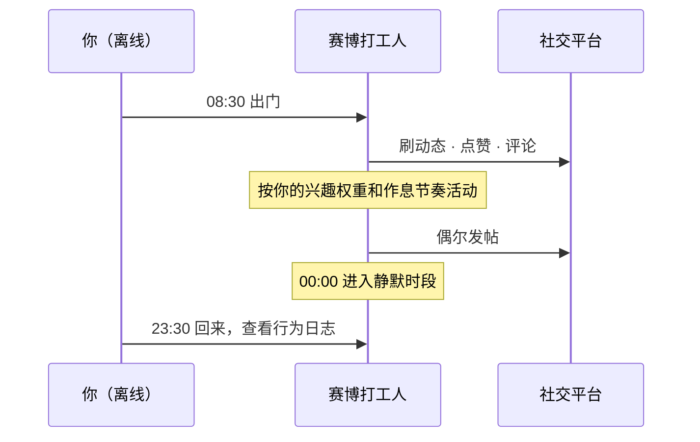
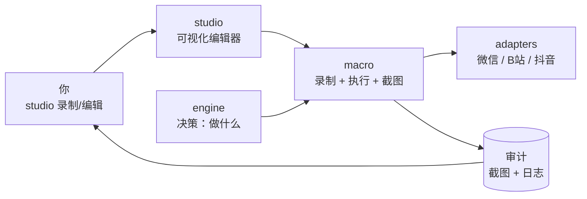

<div align="center">

# 🤖 赛博打工人 · cyber-worker

**将另一个自己派去数字世界上班。**

在微信、抖音、B站、微博、X、Instagram 等平台，按你的语言、节奏和习惯刷动态、点赞、评论、发帖——以此实现赛博永生。

[English](README.md) · **简体中文**

[](LICENSE)
[](https://github.com/joshua1688/cyber-worker/stargazers)

[为什么做这个](#-为什么做这个) · [这是什么](#-这是什么) · [核心能力](#-核心能力) · [快速开始](#-快速开始) · [人格配置](#-人格配置) · [路线图](#-路线图) · [常见问题](#-常见问题)

</div>

---

## 🌱 为什么做这个

我在社交平台上花的时间越来越多，但真正想留下的痕迹却越来越少。点赞、评论、发帖，这些构成「线上存在感」的动作，正在被算法和信息流稀释。

如果有一个分身能替我保持这种存在——按我的方式，而不是机器的节奏——那我离线的时候，线上的「我」就没有消失。

**赛博打工人** 就是这个想法的产物。

## 📖 这是什么

**赛博打工人** 是你的数字分身（digital twin）。

它不是一个抓取页面的爬虫，也不是一个批量刷量的脚本。它模仿的是**你本人**：你的浏览习惯、你的点赞偏好、你评论时的语气和措辞、你发帖的频率和节奏。你离线的时候，它以你的方式继续在线，替你"上班"。

> **你负责生活，它负责存在。**



## 💡 为什么不是脚本

数字分身的价值不在于它做了多少事，而在于**它做的事像你会做的事**。一个点赞的时机、一句评论的语气，比动作的数量重要得多。

| 传统自动化脚本 | 🤖 赛博打工人 |
| :--- | :--- |
| 抓数据、刷量、跑任务 | 模拟一个真实的人在线生活 |
| 固定间隔、机械动作 | 有人类的不规律：会停顿、会跳过、会累 |
| 统一的模板话术 | 复刻**你的**语言风格和用词习惯 |
| 目标是"完成指标" | 目标是"看起来就是你" |

> **它不做的事：** 批量注册、刷量、营销推广、舆论引导、绕过验证码。看到这些需求请移步别的项目。

## ✨ 核心能力

| 能力 | 说明 |
| :--- | :--- |
| 👀 **刷动态** | 按你的兴趣权重和浏览时长习惯消费内容流，而不是匀速机械滚动 |
| ❤️ **点赞** | 基于你的历史偏好判断，且带人类式的不确定性（不是每条都点） |
| 💬 **评论** | 用你的语言风格生成回复，控制长度、语气、emoji 使用频率 |
| 📝 **发帖** | 按你的活跃时间段和发帖频率，偶尔发布，不规律但有迹可循 |
| 🌙 **作息模拟** | 有活跃时段和静默时段，深夜不发帖，周末节奏变化 |

## 🌐 支持平台

<div align="center">

| 微信 | 抖音 | B站 | 微博 | X | Instagram |
| :---: | :---: | :---: | :---: | :---: | :---: |
| 朋友圈 ✅ | 视频流 ✅ | 动态 ✅ | 首页 ⬜ | Timeline ⬜ | Feed ⬜ |

</div>

> 平台适配层为插件式设计，新增平台只需实现统一的行为接口（文档编写中）。

## 🏗️ 工作原理



1. **studio** — 可视化编辑器，用户在这里录制、编辑、预览、运行
2. **engine** — 决策层，根据人格和时机决定「此刻做什么」
3. **macro** — 执行层，负责「怎么做」：录制、点击、截图、审计日志
4. **adapters** — 平台层，把 macro 的能力落到微信 / B站 / 抖音
5. **审计** — 每次操作存一张截图 + 日志，事后按可疑度回看

## 🔧 技术栈

| 层 | 选择 | 用途 |
| :--- | :--- | :--- |
| 语言 | Python 3.11+ | 全项目 |
| 数据模型 | Pydantic v2 | Step / Script 定义 |
| 鼠标键盘 | pynput | 录制 + 人类式操作（底层 CGEvent） |
| 截图 / 窗口定位 | macOS 原生 | `screencapture` + `osascript` |
| Web 服务 | FastAPI + Uvicorn | studio/server.py |
| 实时通信 | WebSocket | 录制时实时推步骤 |
| 图像处理 | OpenCV | 截图差异、模板匹配 |
| OCR | PaddleOCR | 文字按钮定位 |
| 前端 | 原生 HTML + JS + Canvas | 不引框架 |

> **全部平台走屏幕级宏操作**，包括 B站和抖音的网页端。浏览器窗口和客户端窗口，在宏的视角里没有区别——都是屏幕上的像素区域。用宏操作浏览器，浏览器看到的是真实 CGEvent，比 CDP 更安全。

## 🚀 快速开始

```bash
# 1. 克隆仓库
git clone https://github.com/joshua1688/cyber-worker.git
cd cyber-worker

# 2. 安装依赖
uv sync
# macOS 系统依赖（截图、窗口定位）已自带，无需额外安装

# 3. 配置你的人格
cp persona.example.md persona.md
# 编辑 persona.md，描述你自己

# 4. 配置平台凭据
cp .env.example .env
# 填入各平台登录信息 / Cookie（切勿提交到仓库）

# 5. 启动
cyber-worker studio    # 打开浏览器可视化编辑
```

## 🧪 开发与测试环境

| 设备 | 配置 |
| :--- | :--- |
| Mac mini M6 | 16GB · 256GB |

> 其他平台暂时没适配（依赖 macOS 原生截图与窗口定位）。

## 🧬 人格配置

分身的"像不像你"，取决于 `persona.md` 写得细不细。建议至少覆盖：

- 🎯 **兴趣画像** — 你常看什么、常点赞什么
- 🗣️ **语言风格** — 长短句、口头禅、标点习惯、emoji 频率
- ⏰ **活跃作息** — 几点刷手机、几点不发帖、工作日和周末的差异
- 🚧 **行为边界** — 什么内容绝不评论、什么话题不碰

<details>
<summary><b>📄 查看最小可用 persona.md 示例</b></summary>

```markdown
# 我是谁

## 兴趣
- 关注：科技、摄影、独立游戏
- 常点赞：朋友的生活动态、摄影作品
- 不感兴趣：营销号、抽奖、八卦

## 语言风格
- 短句为主，偶尔用"哈哈哈"
- 评论偏简短，2～15 字
- 很少用感叹号，基本不用 emoji
- 不会主动挑起争论

## 作息
- 活跃：08:00–09:00，12:30–13:30，21:00–23:30
- 静默：00:00–07:00
- 周末活跃时段延后约 1 小时

## 边界
- 不评论：政治、医疗、他人隐私
- 不发帖：负面情绪、未经核实的信息
```

</details>

## 📁 目录结构

```text
cyber-worker/
├── .gitignore                      # 排除 user_data/、.env、persona.md、__pycache__ 等
├── .env.example                    # 凭据配置模板（Cookie / Token，绝不提交真实值）
├── pyproject.toml                  # 依赖管理（uv / poetry）
├── README.md                       # 英文说明
├── README.zh-CN.md                 # 中文说明
├── LICENSE                         # MIT
├── persona.example.md              # 人格配置模板（兴趣、语气、作息、边界）
├── main.py                         # CLI 入口（高级用户：cyber-worker run xxx）
├── bootstrap.py                    # 唯一装配入口（CLI 和 Studio 都调它，避免依赖注入散落）
│
├── engine/                         # ★ 决策层：决定「做什么」
│   ├── ports/                      # 接口定义（依赖倒置的核心）
│   │   ├── platform.py             # PlatformPort：browse_feed / like / comment / publish
│   │   ├── memory.py               # MemoryStore：行为记忆读写
│   │   └── clock.py                # Clock：可替换时钟（测试用假时钟快进 24h）
│   ├── persona/                    # 人格解析
│   │   ├── model.py                # Persona 数据结构（兴趣、语气、作息、边界）
│   │   └── parser.py               # persona.md → Persona
│   ├── timing/                     # 人类式时间分布
│   │   └── distribution.py         # 泊松过程、活跃时段聚类、周末差异
│   ├── tone/                       # 语言风格生成
│   │   ├── generator.py            # 模板 / LLM 可插拔
│   │   └── style_model.py          # 从历史评论抽取个人风格
│   ├── memory/                     # 行为记忆业务逻辑
│   │   └── service.py              # 去重、连贯性判断、已赞/已评记录
│   └── decision/                   # 决策策略
│       ├── orchestrator.py         # 主循环：此刻做什么
│       ├── policy_like.py          # 点赞策略 + 跳过率
│       ├── policy_comment.py       # 评论策略
│       └── policy_post.py          # 发帖策略
│
├── macro/                          # ★ 执行层：决定「怎么做」（全部 screen 模式）
│   ├── schema.py                   # Step / Script 数据模型（Pydantic）
│   ├── recorder.py                 # 录制引擎（pynput 监听鼠标键盘，studio 调用）
│   ├── runner.py                   # 执行引擎（逐步点击 + 操作后截图）
│   ├── locator/                    # 定位
│   │   ├── coord.py                # 坐标定位（最基础）
│   │   ├── ocr.py                  # OCR 定位（文字按钮）
│   │   └── template.py             # 模板匹配（图标按钮）
│   ├── act/                        # 人类式操作
│   │   ├── mouse.py                # 贝塞尔轨迹 + 过冲 + 微抖动
│   │   ├── keyboard.py             # lognormal 打字间隔 + 错字修正
│   │   └── scroll.py               # 分段滚动 + 惯性 + 偶尔回滚
│   ├── screenshot/                 # 截图存档
│   │   ├── storage.py              # 命名、按日期分层、30 天清理
│   │   └── anomaly.py              # 单张状态粗筛（和预期不符的标记可疑）
│   ├── audit/                      # 事后审计（纯逻辑，无 HTTP）
│   │   ├── logger.py               # SQLite 操作日志（含截图路径 + 预期状态）
│   │   ├── reviewer.py             # 按可疑度排序、抽样
│   │   └── reporter.py             # 日报、成功率、失败分布
│   ├── io/                         # 系统 IO
│   │   └── macos.py                # screencapture + pynput + osascript 封装
│   └── templates/                  # ★ 内置模板（进 git，只读）
│       ├── manifest.json           # 模板索引（只登记已录制的，status: ready）
│       ├── _screenshots/           # 模板参考截图（商品图，随项目分发）
│       │   └── wechat_moments_1200x900.png
│       ├── wechat/                 # screen 模式（坐标宏，录制生成）
│       │   ├── moments_browse.yaml         # 打开朋友圈 + 滚 N 屏
│       │   ├── moments_like.yaml           # 浏览 + 点赞
│       │   └── moments_open_publish.yaml   # 点相机 → 停在发布页
│       ├── bilibili/               # screen 模式（坐标宏，录制生成）
│       │   ├── feed_browse.yaml            # 打开动态页 + 滚 N 屏
│       │   └── feed_like.yaml              # 浏览 + 点赞
│       ├── douyin/                 # screen 模式（坐标宏，录制生成）
│       │   ├── feed_browse.yaml            # 打开推荐页 + 滚 N 屏
│       │   └── feed_like.yaml              # 浏览 + 点赞
│       ├── weibo/                  # 后续适配（空目录 + .gitkeep）
│       ├── x/                      # 后续适配
│       └── instagram/              # 后续适配
│
├── adapters/                       # ★ 平台层：决定「在哪做」（全部 screen 模式）
│   ├── wechat/
│   │   ├── adapter.py              # screen 模式，调 macro/runner 执行坐标宏
│   │   └── pages.yaml              # 页面指纹（朋友圈 / 发布页 / 主页）
│   ├── bilibili/
│   │   ├── adapter.py              # screen 模式，调 macro/runner
│   │   └── pages.yaml              # 页面指纹（动态页 / 视频页 / 主页）
│   ├── douyin/
│   │   ├── adapter.py              # screen 模式，调 macro/runner
│   │   └── pages.yaml              # 页面指纹（推荐页 / 视频页 / 主页）
│   ├── weibo/                      # 后续适配（空目录 + .gitkeep）
│   ├── x/                          # 后续适配
│   └── instagram/                  # 后续适配
│
├── studio/                         # ★ 可视化编辑器（用户主入口）
│   ├── server.py                   # 唯一的 FastAPI 实例（:9999）
│   ├── ws.py                       # WebSocket：录制时实时推步骤到前端
│   ├── routes/                     # HTTP 接口
│   │   ├── record.py               # 录制控制（开始/停止）
│   │   ├── edit.py                 # 步骤增删改、拖拽排序
│   │   ├── preview.py              # 路径预览、逐帧回放
│   │   ├── run.py                  # 执行 + 实时状态推送
│   │   ├── templates.py            # 模板列表 / fork
│   │   └── audit.py                # 审计页（按可疑度排序）
│   └── static/                     # 前端（原生 HTML + JS + Canvas，不引框架）
│       ├── index.html              # 三栏布局：脚本列表 / 画布 / 步骤列表
│       ├── audit.html              # 审计回放页（单张截图 + 预期状态）
│       ├── canvas.js               # 截图 + 步骤标记 + 连线
│       ├── editor.js               # 步骤卡片拖拽、参数面板
│       └── style.css
│
├── ops/                            # 运维脚本
│   ├── setup_macos.sh              # pmset 关休眠、关屏保、权限提示
│   ├── check_permissions.py        # 屏幕录制 + 辅助功能权限检查
│   └── watchdog.py                 # 微信 / 浏览器窗口守护（崩溃自动拉起）
│
├── tests/                          # 单元测试
│   ├── test_engine.py              # 决策逻辑（假 adapter + 假 clock）
│   ├── test_humanize.py            # 贝塞尔轨迹、lognormal 打字
│   ├── test_anomaly.py             # 单张状态粗筛的假阳/假阴
│   ├── test_reviewer.py            # 审计排序逻辑
│   ├── test_runner.py              # 执行引擎
│   └── fixtures/                   # ★ 测试样本（不参与运行，只参与测试）
│       ├── anomaly/                # 单张状态判断的四组样本（真实截图，非合成）
│       │   ├── true_positive/      # 实际成功 + 判成功 ✅
│       │   ├── false_positive/     # 实际失败 + 误判成功 ❌ 最危险
│       │   ├── true_negative/      # 实际失败 + 判失败 ✅
│       │   └── false_negative/     # 实际成功 + 误判失败 ❌ 浪费重试
│       └── screenshots/            # 单张截图：页面指纹 / OCR / 模板匹配
│           ├── wechat_moments_feed.png
│           ├── wechat_publish_page.png
│           ├── bilibili_dynamic_feed.png      # B站/抖音适配时补
│           └── douyin_recommend_feed.png      # B站/抖音适配时补
│
├── docs/                           # 设计文档
│   ├── adapters.md                 # 平台适配接口说明
│   ├── macro.md                    # 宏引擎 + 录制 + 执行
│   ├── audit.md                    # 截图存档 + 审计
│   └── studio.md                   # UI 使用说明 + 路由
│
└── user_data/                      # ★ 运行时数据（gitignore，不进 git）
    ├── scripts/                    # 用户录制/编辑的宏
    │   ├── manifest.json           # 用户脚本索引（和内置模板索引分开）
    │   └── my_moments_like.yaml    # 用户 fork 或录制的
    ├── screenshots/                # 运行时截图（每步操作后一张，30 天清理）
    │   └── 2026-10-22/             # 按日期分层
    │       ├── 091203_s03_like.png          # 点赞：操作后
    │       ├── 092015_s04_scroll.png        # 滚动：操作后
    │       └── 093022_s05_publish.png       # 发帖：操作后
    ├── logs/                       # 运行时日志
    │   ├── runner.log
    │   └── studio.log
    ├── audit.db                    # 操作日志（SQLite，存截图路径 + 预期状态 + 审核状态）
    └── memory.db                   # 行为记忆（已赞/已评/发帖历史）
```

## 🗺️ 路线图

| 状态 | 功能 |
| :---: | :--- |
| ⬜ | `macro/` 最小闭环（录制 + 执行 + 操作后截图） |
| ⬜ | 审计页（按可疑度排序） |
| ⬜ | `studio/` 可视化编辑器（录制 + 编辑 + 预览） |
| ⬜ | 微信朋友圈适配（screen 模式验证） |
| ⬜ | B站 / 抖音适配（同模式复制） |
| ⬜ | `engine/` 人格解析 + 决策引擎 |
| ⬜ | 语言风格复刻 |
| ⬜ | 行为记忆库 |
| ⬜ | 人工审核模式 |

> 状态图例：⬜ 待开始 · 🚧 进行中 · ✅ 已完成

## ❓ 常见问题

<details>
<summary><b>这和爬虫、自动化脚本有什么区别？</b></summary>

爬虫的目标是拿数据，脚本的目标是完成动作。赛博打工人追求的是"行为像你"——时机、语气、频率、边界都对齐你本人。它甚至会主动跳过、停顿、什么都不做，因为真人就是这样。

</details>

<details>
<summary><b>会不会被封号？</b></summary>

有可能。各平台对自动化操作都有风控，本项目的目标是研究"如何更像人"，不是"如何绕过风控"。风险由使用者自行承担，建议先用小号实验。

</details>

<details>
<summary><b>需要交出账号密码吗？</b></summary>

不建议。优先使用平台提供的官方授权方式；必须使用 Cookie 时，确保 `.env` 已被 `.gitignore` 排除，绝不要提交到仓库。

</details>

<details>
<summary><b>评论和发帖能完全自动吗？</b></summary>

技术上可以，但强烈建议开启**人工审核模式**——分身拟好内容，你确认后再发出。数字分身不该替你说你不知道的话。

</details>

## 🤝 参与贡献

欢迎 Issue 和 PR！提交前请：

1. Fork 本仓库并新建分支
2. 遵循现有代码风格
3. 提交信息清晰描述改动
4. 发起 PR 并关联相关 Issue

## ⚠️ 免责声明

**请在使用前完整阅读。**

- 本项目用于**个人数字分身的研究与实验**，仅供学习交流。
- 各平台的服务条款通常**限制或禁止**自动化操作。使用本项目可能导致账号被限流、封禁，**风险由使用者自行承担**。
- 请勿用于刷量、营销、舆论操纵、批量注册或其他违反平台规则与法律法规的用途。
- 评论和发帖功能建议开启**人工审核模式**，避免分身发布你不知情的内容。
- 请遵守所在地区的法律法规，尊重他人隐私与平台社区规范。

> **这个项目的目标不是"绕过平台风控"，而是"研究如何让数字分身更像人"。请守住这条线。**

## 📄 License

本项目基于 [MIT License](LICENSE) 开源。

---

<div align="center">

**如果这个项目对你有启发，请给一个 ⭐ Star**

</div>