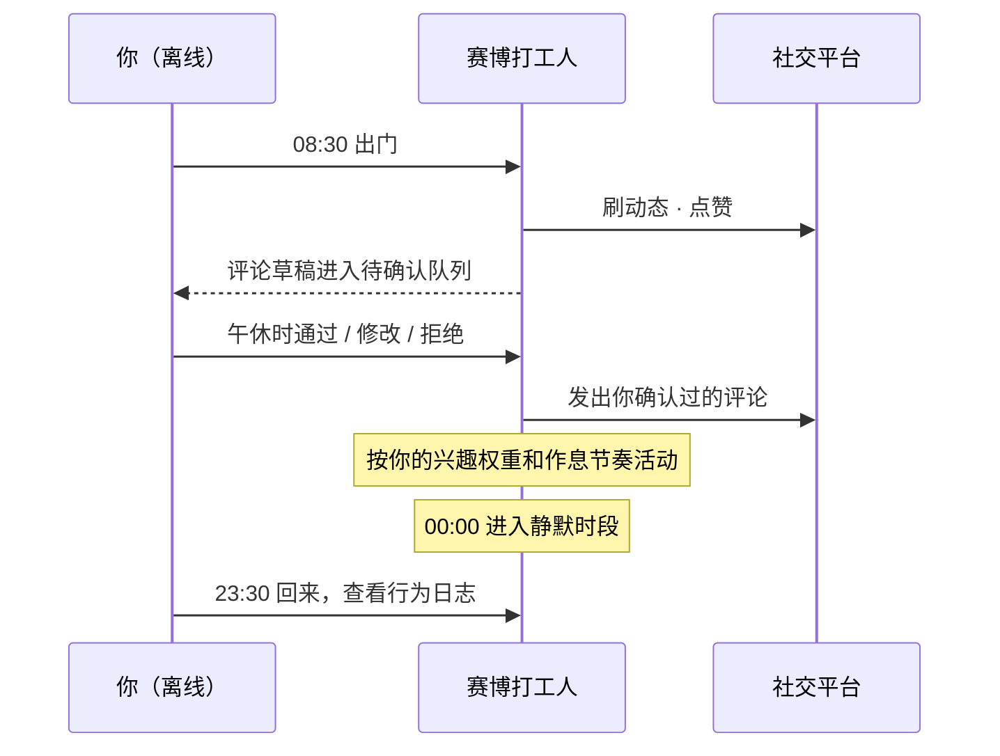
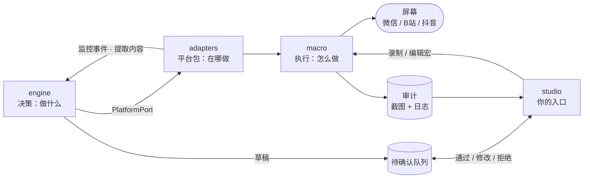
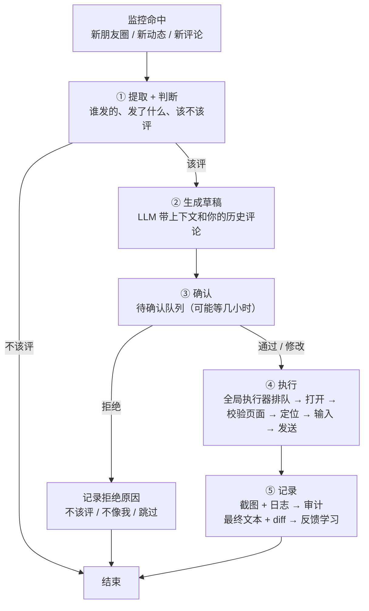

<div align="center">

# 🤖 赛博打工人 · cyber-worker

**将另一个自己派去数字世界上班。**

在微信、抖音、B站、微博、X、Instagram 等平台，按你的语言、节奏和习惯刷动态、点赞、评论、发帖——以此实现赛博永生。

[English](README.md) · **简体中文**

[](LICENSE)
[](https://www.python.org/downloads/)

**[🚀 快速开始 →](#-快速开始)**

</div>

---

## 🌱 为什么做这个

我在社交平台上花的时间越来越多，但真正想留下的痕迹却越来越少。点赞、评论、发帖，这些构成「线上存在感」的动作，正在被算法和信息流稀释。

如果有一个分身能替我保持这种存在——按我的方式，而不是机器的节奏——那我离线的时候，线上的「我」就没有消失。

**赛博打工人** 就是这个想法的产物。

> ~~啊——我要飞升了，长生不老梦，实现了，我、赛博永生啦~~ (≧▽≦)

## 📖 这是什么

**赛博打工人** 是你的数字分身（digital twin）。

它不是一个抓取页面的爬虫，也不是一个批量刷量的脚本。它模仿的是**你本人**：你的浏览习惯、你的点赞偏好、你评论时的语气和措辞、你发帖的频率和节奏。你离线的时候，它以你的方式继续在线，替你"上班"。

> **你负责生活，它负责存在。**



## 💡 为什么不是脚本

数字分身的价值不在于它做了多少事，而在于**它做的事像你会做的事**。一个点赞的时机、一句评论的语气，比动作的数量重要得多。

| 传统自动化脚本 | 🤖 赛博打工人 |
| :--- | :--- |
| 抓数据、刷量、跑任务 | 模拟一个真实的人在线生活 |
| 固定间隔、机械动作 | 有人类的不规律：会停顿、会跳过、会累 |
| 统一的模板话术 | 复刻**你的**语言风格和用词习惯 |
| 目标是"完成指标" | 目标是"看起来就是你" |

> **它不做的事：** 批量注册、刷量、营销推广、舆论引导、绕过验证码。看到这些需求请移步别的项目。

## ✨ 核心能力

| 能力 | 说明 |
| :--- | :--- |
| 👀 **刷动态** | 按你的兴趣权重和浏览时长习惯消费内容流，而不是匀速机械滚动 |
| ❤️ **点赞** | 基于你的历史偏好判断，且带人类式的不确定性（不是每条都点） |
| 💬 **评论** | 监控新动态和新评论，按你的语气生成草稿，**先进待确认队列**，你确认后才发出 |
| 📝 **发帖** | 按你的活跃时间段和发帖频率生成草稿，**同样先进待确认队列**，不规律但有迹可循 |
| 🌙 **作息模拟** | 有活跃时段和静默时段，深夜不发帖，周末节奏变化 |
| 🙋 **让出电脑** | 检测到你正在用电脑时自动暂停，等你离开再继续；按急停快捷键随时叫停 |

> 评论和发帖这类「替你说话」的动作，都会先进**待确认队列**——**通过、修改、拒绝都是学习信号**。等确认和修改越来越少、生成的内容已经贴合你的表达习惯后，可在 `config.toml` 中按动作分别开启「自动发出，无需确认」。

## 🌐 支持平台

<div align="center">

| 微信 | 抖音 | B站 | 微博 | X | Instagram |
| :---: | :---: | :---: | :---: | :---: | :---: |
| 朋友圈 🚧 | 视频流 ⬜ | 动态 ⬜ | 首页 ⬜ | Timeline ⬜ | Feed ⬜ |

</div>

> 状态图例：⬜ 待开始 · 🚧 进行中 · ✅ 已完成

> 平台适配层是**声明式的平台包**：每个平台就是一个目录，里面只有 `platform.yaml`（能力 → 宏的映射、提取字段）、`pages.yaml`（页面指纹、监控区域）和录制好的宏。所有平台由同一个通用 `ScreenAdapter` 驱动。内置平台开箱即用；其他平台或私人场景，在 `studio` 里录制并保存成平台包即可，**无需改代码**。只有提取逻辑特别复杂时，才需要写一个可选的 `hooks.py`。
>
> 平台包可以**一键导出**成一个 `.cwpack` 文件分享给其他人，对方把文件拖进 studio 页面就导入完成，立刻拥有整套平台操作。导出时默认带上录制时的窗口截图（每个窗口的参考图、每一步的画面），对方打开宏就能看到每一步在哪操作；截图里可能有聊天内容，不想分享可以在设置里关掉（执行只看锚点和目标图，不受影响）。草稿和运行截图不打进去；导入时自动校验文件，同名的宏自动加 `-2` 后缀，不弹任何确认框。

## 🏗️ 工作原理



1. **studio**：可视化编辑器，也是你的主入口。在这里录制和编辑宏、确认待发动作、回看审计。
2. **engine**：决策层，负责「此刻做什么」。它监控新内容、按作息挑时机、判断该不该互动、生成草稿，并推进待确认动作的工作流。
3. **adapters**：平台层，负责「在哪做」。通用 `ScreenAdapter` 读取平台包的声明，实现监控、提取，并调用宏。
4. **macro**：执行层，负责「怎么做」。全局排队执行、校准窗口、拟人操作、每步操作后截图；不认识任何具体平台。
5. **infra**：存储（SQLite）和 LLM 客户端的具体实现。
6. **审计**：每次操作存一张截图和一条日志，事后按可疑度回看。

> **依赖方向：** engine 只依赖 `engine/ports/` 里的接口；adapters 和 infra 负责实现这些接口；macro 与平台无关；所有装配都在 `bootstrap.py` 一处完成。CLI 和 studio 都通过它启动。

## 🔄 评论与发帖工作流

监控到新内容，不代表要评论。大部分新内容看完就过了，只有少数值得互动。

值得评的，从发现到发出要经过五步，中间任何一步都可以停：



每一步归谁管，看这张表：

| 步骤 | 位置 | 说明 |
| :--- | :--- | :--- |
| 监控 | `engine/monitor.py` + `adapters/<平台>/pages.yaml` | 通用循环轮询各平台声明的监控区域，和基准图比对后产生「新内容」事件 |
| ① 提取 | `adapters/<平台>/platform.yaml`（可选 `hooks.py`） | 平台相关。声明在哪个区域、用 OCR 读出哪些字段（作者、正文、是否转发、是否带话题） |
| ① 判断 | `engine/decision/policy_comment.py` | 通用。关系名单、频率上限、随机门槛，全平台共用 |
| ② 生成 | `engine/tone/generator.py` | 通用。经 `ports/llm.py` 调用 LLM，只带生成所需的最少上下文和你的历史评论 |
| ③ 确认 | `engine/ports/review.py`（实现在 `infra/sqlite/`） | 通用。待确认队列是领域逻辑；`studio/routes/pending.py` 只负责展示和提交你的选择 |
| ④ 执行 | `adapters/<平台>/templates/` → `macro/executor.py` | 平台宏 + 全局执行器。与其他动作互斥排队；输入和发送前核对页面指纹，对不上就中止 |
| ⑤ 记录 | `macro/audit/` + `engine/tone/feedback.py` | 截图和操作日志进审计；最终文本、diff 和你的选择进反馈学习与行为记忆 |
| 串联 | `engine/workflow/comment.py` | 跨时间的状态机：`待确认 → 已通过 / 已修改 / 已拒绝 → 已执行 / 执行失败`。确认后由它触发执行，studio 不直接调用 macro |

**发帖**走同一个待确认队列，只是起点不同：不由监控触发，而是由 `policy_post.py` 按你的作息和发帖频率挑时机，在 `engine/workflow/post.py` 里走「时机 → 生成 → 确认 → 执行 → 记录」。

**判断用规则**（关系名单、频率上限、随机门槛），**生成用 LLM**（带上下文和你的历史评论）。你的三种动作各学各的：**通过**强化这个风格，**修改**的 diff 是最强信号，**拒绝**按原因分别调整判断（不该评）或否定表达（不像我）。

## 🔧 技术栈

| 层 | 选择 | 用途 |
| :--- | :--- | :--- |
| 语言 | Python 3.11+ | 全项目（`src/` 布局，uv 管理） |
| 数据模型 | Pydantic v2 | Step / Script、平台包声明 |
| 配置 | pydantic-settings + TOML | `config.toml` 运行配置、`.env` 密钥 |
| 存储 | SQLite | `state.db`：待确认队列、行为记忆、审计日志 |
| LLM | 可插拔（经 `ports/llm.py`），支持云端 API 或本地模型 | 评论 / 发帖草稿生成 |
| 鼠标键盘 | pynput（Windows 打字走 SendInput） | 录制 + 人类式操作（macOS 底层 CGEvent） |
| 截图 / 窗口定位 | macOS：`screencapture` + `osascript`；Windows：Win32 + Pillow | 按进程名（可选窗口标题）找窗口、调尺寸、截图 |
| Web 服务 | FastAPI + Uvicorn | studio |
| 实时通信 | WebSocket | 录制时实时推步骤 |
| 图像处理 | OpenCV | 区域变化检测、模板匹配、页面指纹 |
| OCR | PaddleOCR | 文字按钮定位、内容提取 |
| 前端 | 原生 HTML + JS + Canvas | 纯 Web，不引任何前端 / 桌面 UI 框架；深色 / 浅色外观、设置中心、新手引导 |

## 🖱️ 执行约定

- **全部平台走屏幕级宏操作**，包括 B站和抖音的网页端。浏览器窗口和客户端窗口，在宏的视角里没有区别——都是屏幕上的像素区域。用宏操作浏览器，浏览器看到的是真实 CGEvent，比 CDP 更安全。
- **只有一套鼠标键盘**：studio 录制、手动运行、engine 定时动作，全部经过 `macro/executor.py` 排队，互斥执行。检测到你正在用电脑时，执行器暂停让出，等你空闲后再继续。
- **坐标相对窗口**：宏记录的是窗口内坐标，同时记下录制时的窗口尺寸和屏幕缩放倍率（macOS Retina / Windows 显示缩放）。执行前先把窗口校准到相同尺寸，避免换了分辨率就点歪。
- **先认页面，再动手**：每一步都可以声明「此时应该在哪个页面」（`expected_page`）。输入和发送之前，runner 必须先核对页面指纹；对不上就中止，并在审计里标记为可疑——宁可不发，也不能把评论打进错误的聊天窗口。
- **输入前先清空**：输入步骤默认先全选删除输入框里的内容（macOS ⌘A / Windows Ctrl+A），空跑或被打断后残留的文字不会跟着下一次一起发出去。
- **急停**：全局快捷键（默认 macOS `⌃⌥⌘.`、Windows `Ctrl+Alt+Shift+.`，可在 studio 的「设置 · 快捷键」里改，跟别的软件冲突会当场提示）会立刻中止当前动作并清空执行队列，已中止的动作同样会留下审计记录。
- **空跑模式**：开启 `dry_run` 后，完整走一遍「打开 → 定位 → 输入」，但跳过最后一步「发送」，并照常截图和写审计。录完新宏、换了窗口尺寸之后，先空跑一遍再上线。

## 🚀 快速开始

```bash
# 1. 克隆仓库
git clone https://github.com/joshua1688/cyber-worker.git
cd cyber-worker

# 2. 安装依赖
uv sync
# macOS / Windows 的系统依赖（截图、窗口定位）已自带，无需额外安装

# 3. 配置你的人格（你是谁）
cp persona.example.md persona.md

# 4. 配置运行参数（启用平台、频率上限、关系名单、是否自动发出）
cp config.example.toml config.toml

# 5. 配置密钥（只需要 LLM API Key；用本地模型可以不填）
cp .env.example .env
# 不需要任何平台的账号密码或 Cookie——分身操作的是你已登录的客户端 / 浏览器窗口

# 6. macOS：检查系统权限（屏幕录制 + 辅助功能 + 输入监控）
uv run ops/check_permissions.py

# 7. 启动
uv run cyber-worker studio    # 浏览器打开 http://127.0.0.1:9999，首次打开有新手引导
```

> 首次使用建议在客户端里登录**小号**实验。

## 🧪 开发与测试环境

| 设备 | 配置 |
| :--- | :--- |
| Mac mini M6 | 16GB · 256GB |
| Windows 10 / 11 开发机 | — |

> 支持 macOS 和 Windows。Linux 暂未适配（没有统一的窗口定位方式）。

## 🧬 人格与配置

分身的"像不像你"，取决于 `persona.md` 写得细不细。建议至少覆盖：

- 🎯 **兴趣画像** — 你常看什么、常点赞什么
- 🗣️ **语言风格** — 长短句、口头禅、标点习惯、emoji 频率
- ⏰ **活跃作息** — 几点刷手机、几点不发帖、工作日和周末的差异
- 🚧 **行为边界** — 什么内容绝不评论、什么话题不碰

`persona.md` 描述**你是谁**；开关、上限和名单这类**运行参数**放在 `config.toml`。

<details>
<summary><b>📄 查看最小可用 persona.md 示例</b></summary>

```markdown
# 我是谁

## 兴趣
- 关注：科技、摄影、独立游戏
- 常点赞：朋友的生活动态、摄影作品
- 不感兴趣：营销号、抽奖、八卦

## 语言风格
- 短句为主，偶尔用"哈哈哈"
- 评论偏简短，2～15 字
- 很少用感叹号，基本不用 emoji
- 不会主动挑起争论

## 作息
- 活跃：08:00–09:00，12:30–13:30，21:00–23:30
- 静默：00:00–07:00
- 周末活跃时段延后约 1 小时

## 边界
- 不评论：政治、医疗、他人隐私
- 不发帖：负面情绪、未经核实的信息
```

</details>

<details>
<summary><b>⚙️ 查看最小可用 config.toml 示例</b></summary>

```toml
[platforms]
enabled = ["wechat"]

[review]
comment_auto_send = false   # 确认和修改足够少之后再打开
post_auto_send = false

[limits]
comments_per_day = 5
posts_per_week = 2

[relations]
close_friends = ["张三", "李四"]   # 优先互动
never_comment = ["工作群同事"]       # 永不评论

[executor]
pause_on_user_input = true    # 你在用电脑时暂停
resume_after_idle_sec = 120   # 空闲多久后继续
panic_hotkey = "ctrl+alt+cmd+." # 急停：中止当前动作并清空队列
dry_run = false               # 空跑：完整执行但跳过最后的「发送」

[llm]
provider = "local"            # local / 云端厂商名；云端需要在 .env 填 API Key
```

</details>

## 📁 目录结构

```text
cyber-worker/
├── .gitignore                      # 排除 user_data/、.env、config.toml、persona.md、__pycache__ 等
├── .env.example                    # 密钥模板（只有 LLM API Key，绝不提交真实值）
├── config.example.toml             # 运行配置模板（平台、频率上限、关系名单、自动发出、急停、空跑、LLM）
├── persona.example.md              # 人格配置模板（兴趣、语气、作息、边界）
├── pyproject.toml                  # 依赖管理（uv），声明 cyber-worker 命令入口
├── README.md                       # 英文说明
├── README.zh-CN.md                 # 中文说明
├── LICENSE                         # MIT
│
├── src/cyber_worker/
│   ├── cli.py                      # CLI 入口（cyber-worker record / anchor / run / studio）
│   ├── bootstrap.py                # 唯一装配入口（CLI 和 studio 都调它，避免依赖注入散落）
│   ├── config.py                   # 读取 config.toml + .env（pydantic-settings）
│   │
│   ├── engine/                     # ★ 决策层：决定「做什么」（只依赖 ports）
│   │   ├── ports/                  # 接口定义（依赖倒置的核心）
│   │   │   ├── platform.py         # PlatformPort：watch / extract / browse_feed / like / comment / publish
│   │   │   ├── review.py           # ReviewQueue：入队 / 通过 / 修改 / 拒绝（带原因）
│   │   │   ├── memory.py           # MemoryStore：行为记忆读写
│   │   │   ├── llm.py              # LLM：草稿生成接口
│   │   │   └── clock.py            # Clock：可替换时钟（测试用假时钟快进 24h）
│   │   ├── persona/                # 人格解析
│   │   │   ├── model.py            # Persona 数据结构（兴趣、语气、作息、边界）
│   │   │   └── parser.py           # persona.md → Persona
│   │   ├── timing/                 # 人类式时间分布
│   │   │   └── distribution.py     # 泊松过程、活跃时段聚类、周末差异
│   │   ├── tone/                   # 语言风格生成与学习
│   │   │   ├── generator.py        # 模板 / LLM 可插拔（评论、发帖草稿生成）
│   │   │   ├── style_model.py      # 从「通过 / 修改 / 拒绝」三种反馈中学习语言风格
│   │   │   └── feedback.py         # 反馈分流：通过→强化，修改→学 diff，拒绝→按原因分流
│   │   ├── memory/                 # 行为记忆业务逻辑
│   │   │   └── service.py          # 去重、连贯性判断、已赞/已评记录
│   │   ├── decision/               # 决策策略
│   │   │   ├── orchestrator.py     # 主循环：调度监控、浏览、点赞，推进各工作流
│   │   │   ├── policy_like.py      # 点赞策略 + 跳过率
│   │   │   ├── policy_comment.py   # 评论策略：该不该评（规则 + 随机门槛），拒绝原因反哺判断
│   │   │   └── policy_post.py      # 发帖策略：按作息和频率挑时机
│   │   ├── workflow/               # 跨时间的待确认动作状态机
│   │   │   ├── comment.py          # 提取 → 判断 → 生成 → 入队 →（确认后）执行 → 记录
│   │   │   └── post.py             # 时机 → 生成 → 入队 →（确认后）执行 → 记录
│   │   └── monitor.py              # 轮询各平台监控区域，产生「新内容」事件
│   │
│   ├── macro/                      # ★ 执行层：决定「怎么做」（与平台无关）
│   │   ├── schema.py               # Step / Script 数据模型（坐标相对窗口、窗口尺寸与缩放倍率、每步 expected_page）
│   │   ├── recorder.py             # 录制引擎（pynput 监听鼠标键盘，操作间隔录成延迟行）
│   │   ├── anchors.py              # 从截图框选区域 → 页面锚点（studio 和 CLI 共用）
│   │   ├── runner.py               # 执行单个脚本：校准窗口 → 逐步操作（输入/发送前校验页面）→ 操作后截图；支持空跑
│   │   ├── executor.py             # 全局执行器：所有动作排队互斥，你在用电脑时暂停，急停热键清空队列
│   │   ├── locator/                # 定位（决定点哪里，具体识别交给 vision/）
│   │   │   ├── coord.py            # 坐标定位（最基础）
│   │   │   ├── text.py             # 文字按钮（调 vision/ocr）
│   │   │   └── icon.py             # 图标按钮（调 vision/template）
│   │   ├── vision/                 # 视觉识别（纯图像算法）
│   │   │   ├── ocr.py              # PaddleOCR 封装
│   │   │   ├── template.py         # OpenCV 模板匹配
│   │   │   ├── fingerprint.py      # 页面指纹：判断当前在哪个页面
│   │   │   ├── detect.py           # 区域变化检测（圈选区域 vs 基准图），供监控使用；录制时判断画面变没变
│   │   │   └── anomaly.py          # 单张状态粗筛（和预期不符的标记可疑）
│   │   ├── act/                    # 人类式操作
│   │   │   ├── mouse.py            # 贝塞尔轨迹 + 过冲 + 微抖动
│   │   │   ├── keyboard.py         # lognormal 打字间隔 + 错字修正
│   │   │   └── scroll.py           # 分段滚动 + 惯性 + 偶尔回滚
│   │   ├── screenshot/             # 截图存档
│   │   │   ├── storage.py          # 命名、按日期分层、30 天清理
│   │   │   └── baseline.py         # 基准图存取（圈选时存、检测时读）
│   │   ├── audit/                  # 事后审计（纯逻辑，无 HTTP）
│   │   │   ├── logger.py           # 操作日志（截图路径 + 预期状态）
│   │   │   ├── reviewer.py         # 按可疑度排序、抽样
│   │   │   └── reporter.py         # 日报、成功率、失败分布
│   │   └── io/                     # 系统 IO
│   │       ├── base.py             # ScreenIO / ActivityMonitor 接口（测试用假实现）
│   │       ├── pynput_input.py     # 键鼠操作、真实输入监听、全局热键（两个系统共用）
│   │       ├── hotkeys.py          # 全局快捷键管理：冲突检查、被占用时自动换备选、改键立即生效
│   │       ├── effects.py          # 执行特效：点击 / 双击 / 长按 / 拖动 / 滚动 / 按键在屏幕上画出来
│   │       ├── win_overlay.py      # 特效的 Windows 画法（点不到、截不到的透明置顶小窗口）
│   │       ├── sounds.py           # 执行音效：鼠标点击、青轴打字（录音素材在 sound_assets/）、回车，混音（几个声音能叠着响）
│   │       ├── win_sound.py        # 音效的 Windows 播放（waveOut 流式送声卡，安静了就关）
│   │       ├── macos.py            # screencapture + osascript（窗口校准、截图）
│   │       └── windows.py          # Win32 + Pillow（窗口校准、截图、绕过输入法打字、系统热键注册）
│   │
│   ├── adapters/                   # ★ 平台层：决定「在哪做」（声明式平台包）
│   │   ├── screen_adapter.py       # 通用 PlatformPort 实现：读取平台包声明，调 macro 执行
│   │   ├── loader.py               # 加载平台包（内置 + user_data/platforms/，同名文件用户版优先）
│   │   ├── pack.py                 # 平台包导出 / 导入（.cwpack：打包、安全校验、解压）
│   │   ├── wechat/
│   │   │   ├── platform.yaml       # 能力 → 宏映射、提取字段（区域 + OCR）、窗口尺寸
│   │   │   ├── pages.yaml          # 页面指纹 + 监控区域（朋友圈 / 发布页 / 主页）
│   │   │   ├── templates/          # 坐标宏（录制生成，只读）
│   │   │   │   ├── moments_browse.yaml     # 打开朋友圈 + 滚 N 屏
│   │   │   │   ├── moments_like.yaml       # 浏览 + 点赞
│   │   │   │   ├── moments_comment.yaml    # 评论指定动态（带 comment_draft 变量）
│   │   │   │   └── moments_publish.yaml    # 点相机 → 输入 → 发布（带 post_draft 变量）
│   │   │   └── reference/          # 参考截图（测试账号录制，随项目分发）
│   │   │       └── moments_1200x900.png
│   │   ├── bilibili/               # 同上：platform.yaml + pages.yaml + templates/
│   │   │   └── templates/          # feed_browse / feed_like / feed_comment
│   │   ├── douyin/                 # 同上
│   │   │   └── templates/          # feed_browse / feed_like / feed_comment
│   │   ├── weibo/                  # 后续适配（空目录 + .gitkeep）
│   │   ├── x/                      # 后续适配
│   │   └── instagram/              # 后续适配
│   │
│   ├── infra/                      # ★ 接口的具体实现（由 bootstrap 装配）
│   │   ├── sqlite/
│   │   │   ├── db.py               # state.db 连接与迁移
│   │   │   ├── memory_store.py     # MemoryStore 实现
│   │   │   ├── review_queue.py     # ReviewQueue 实现
│   │   │   └── audit_store.py      # 审计日志存储
│   │   └── llm/
│   │       └── client.py           # LLM 实现（云端 API / 本地模型可替换）
│   │
│   └── studio/                     # ★ 可视化编辑器（用户主入口）
│       ├── server.py               # 唯一的 FastAPI 实例（:9999）
│       ├── state.py                # 共享状态：脚本目录、最新截图帧、录制会话、问题检查
│       ├── ws.py                   # WebSocket：录制时实时推步骤、执行时实时推每一步结果
│       ├── routes/                 # HTTP 接口（只做展示与提交，不含业务逻辑）
│       │   ├── edit.py             # 宏的增删改查、截取当前窗口、页面锚点
│       │   ├── record.py           # 录制控制（开始/停止；默认替换已有步骤，可选追加到末尾）
│       │   ├── preview.py          # 图片读取（参考图、截图、锚点图，只限 user_data）
│       │   ├── run.py              # 空跑 / 执行（进执行器排队）、急停、实时状态推送
│       │   ├── hotkeys.py          # 设置 · 快捷键（查冲突、改键写回 config.toml）
│       │   ├── settings.py         # 设置 · 外观、录制与执行（立即生效，写回 config.toml）
│       │   ├── packs.py            # 平台包一键导出（下载 .cwpack）/ 导入（上传或拖入页面）
│       │   ├── pending.py          # 待确认动作（评论 + 发帖；通过 / 修改 / 拒绝，拒绝需选原因）
│       │   └── audit.py            # 审计页（按可疑度排序）
│       └── static/                 # 前端（原生 HTML + JS + Canvas，不引框架）
│           ├── index.html          # 宏设计：添加 / 步骤列表 / 画布 + 参数·宏设置·运行 标签页
│           ├── pending.html        # 待确认动作页
│           ├── audit.html          # 审计回放页（单张截图 + 预期状态）
│           ├── common.js           # 图标、外观（深色 / 浅色 / 跟随系统）、请求封装、提示、WebSocket
│           ├── tour.js             # 新手引导（高亮 + 分步说明，首次自动出现）
│           ├── settings.js         # 设置中心（齿轮）：外观、快捷键（直接按键录入、实时冲突提示）、录制与执行、关于
│           ├── canvas.js           # 截图 + 步骤标记 + 连线 + 锚点框 + 区域框选
│           ├── editor.js           # 步骤列表（勾选、拖拽排序、撤销重做）、参数面板、录制、执行
│           ├── audit.js            # 审计列表、标记、快捷键
│           └── style.css
│
├── ops/                            # 运维脚本
│   ├── setup_macos.sh              # pmset 关休眠、关屏保、权限提示
│   ├── check_permissions.py        # 屏幕录制 + 辅助功能权限检查
│   └── watchdog.py                 # 微信 / 浏览器窗口守护（崩溃自动拉起）
│
├── tests/                          # 单元测试（目录与 src 对应）
│   ├── engine/
│   │   ├── test_decision.py        # 决策逻辑（假 adapter + 假 clock）
│   │   ├── test_workflow.py        # 待确认动作状态机（假 ReviewQueue）
│   │   └── test_feedback.py        # 反馈分流逻辑（三种动作 → 各自的模型）
│   ├── macro/
│   │   ├── test_humanize.py        # 贝塞尔轨迹、lognormal 打字
│   │   ├── test_executor.py        # 排队互斥、用户输入时暂停、急停清空队列
│   │   ├── test_runner.py          # 执行引擎、窗口校准、页面不符即中止、空跑不发送
│   │   ├── test_detect.py          # 区域变化检测（真阳/假阳/真阴/假阴）
│   │   ├── test_anomaly.py         # 单张状态粗筛的假阳/假阴
│   │   └── test_reviewer.py        # 审计排序、抽查、日报
│   ├── adapters/
│   │   ├── test_screen_adapter.py  # 平台包加载、能力映射、用户版覆盖
│   │   └── test_pack.py            # 平台包导出 / 导入：往返一致、截图可带可不带、跳过草稿、拒绝坏包与路径穿越
│   ├── studio/
│   │   └── test_studio_api.py      # studio 接口（fake IO）：新建、保存、锚点、录制、空跑、审计
│   └── fixtures/                   # ★ 测试样本（只用测试账号截图或已打码，走 Git LFS）
│       ├── anomaly/                # 单张状态判断的四组样本（真实截图，非合成）
│       │   ├── true_positive/      # 实际成功 + 判成功 ✅
│       │   ├── false_positive/     # 实际失败 + 误判成功 ❌ 最危险
│       │   ├── true_negative/      # 实际失败 + 判失败 ✅
│       │   └── false_negative/     # 实际成功 + 误判失败 ❌ 浪费重试
│       ├── detect/                 # 区域变化检测的四组样本（同上）
│       └── screenshots/            # 单张截图：页面指纹 / OCR / 模板匹配
│           ├── wechat_moments_feed.png
│           ├── wechat_publish_page.png
│           ├── bilibili_dynamic_feed.png      # B站/抖音适配时补
│           └── douyin_recommend_feed.png      # B站/抖音适配时补
│
├── docs/                           # 设计文档
│   ├── adapters.md                 # 平台包格式：platform.yaml / pages.yaml / templates
│   ├── macro.md                    # 宏引擎 + 录制 + 执行器 + 窗口校准
│   ├── workflow.md                 # 待确认动作状态机与反馈信号
│   ├── audit.md                    # 截图存档 + 审计
│   └── studio.md                   # UI 使用说明 + 路由
│
└── user_data/                      # ★ 运行时数据（gitignore，不进 git）
    ├── platforms/                  # 你录制或 fork 的平台包（格式同 adapters/<平台>/，同名覆盖内置）
    │   └── wechat/templates/my_moments_like.yaml
    ├── baselines/                  # 圈选区域的基准图（每个 tag 一张）
    │   ├── wechat/
    │   │   ├── new_comment.png     # 消息图标右上角
    │   │   └── new_moments.png     # 内容区顶部
    │   └── douyin/
    │       └── new_message.png
    ├── screenshots/                # 运行时截图（每步操作后一张，无损 WebP，默认保留 30 天，可在设置里改）
    │   └── 2026-10-22/             # 按日期分层
    │       ├── 091203_s03_like.webp         # 点赞：操作后
    │       ├── 092015_s04_scroll.webp       # 滚动：操作后
    │       └── 093022_s05_publish.webp      # 发帖：操作后
    ├── logs/                       # 运行时日志
    │   ├── runner.log
    │   └── studio.log
    └── state.db                    # SQLite：待确认队列（含你的选择与拒绝原因）+ 行为记忆 + 审计日志
```

## 🗺️ 路线图

| 状态 | 功能 |
| :---: | :--- |
| 🚧 | `macro/` 最小闭环（录制 + 窗口校准 + 页面校验 + 执行 + 操作后截图 + 空跑）：Windows 已实测，待 macOS 实机验证 |
| 🚧 | 全局执行器（动作排队互斥、你在用电脑时暂停、急停）：Windows 已实测，待 macOS 实机验证 |
| ✅ | 审计页（按可疑度排序、抽查、日报；出问题的步骤附「怎么修」和直达修改的按钮） |
| ✅ | `studio/` 宏设计器（新建 + 录制 + 编辑 + 锚点 + 按图找点击 + 等待页面 + 空跑 / 执行 + 深色 / 浅色外观 + 设置中心 + 新手引导；报错都附一键修复） |
| ✅ | 平台包导出 / 导入（一键导出 `.cwpack`，拖进页面即导入，方便分享给其他人） |
| ⬜ | 按文字找点击（OCR，`locator/text.py` + `vision/ocr.py`） |
| ⬜ | 平台包格式 + 通用 `ScreenAdapter`，用微信朋友圈验证 |
| ⬜ | B站 / 抖音适配（只新增平台包，不改代码） |
| ⬜ | `engine/` 人格解析 + 决策引擎 + 监控 |
| ⬜ | 语言风格复刻 |
| ⬜ | 行为记忆库 |
| ⬜ | 待确认队列 + 评论 / 发帖工作流（判断 → 生成 → 确认 → 执行 → 记录） |

> 状态图例：⬜ 待开始 · 🚧 进行中 · ✅ 已完成

## ❓ 常见问题

<details>
<summary><b>这和爬虫、自动化脚本有什么区别？</b></summary>

爬虫的目标是拿数据，脚本的目标是完成动作。赛博打工人追求的是"行为像你"——时机、语气、频率、边界都对齐你本人。它甚至会主动跳过、停顿、什么都不做，因为真人就是这样。

</details>

<details>
<summary><b>会不会被封号？</b></summary>

有可能。各平台对自动化操作都有风控，本项目的目标是研究"如何更像人"，不是"如何绕过风控"。风险由使用者自行承担，建议先用小号实验。

</details>

<details>
<summary><b>需要交出账号密码吗？</b></summary>

不需要。分身操作的是你自己已经登录好的客户端或浏览器窗口，项目不保存任何平台的账号、密码或 Cookie。`.env` 里只有 LLM 的 API Key。

</details>

<details>
<summary><b>评论和发帖能完全自动吗？</b></summary>

后期可以，但**前期必须走待确认队列**——分身拟好内容，你确认后再发出。

确认不只是安全阀，更是训练过程：每一次通过、修改、拒绝，都是在教模型「这句话你会怎么说、那句话你不会说」。等确认和修改越来越少、生成的内容已经贴合你的表达习惯后，可以在 `config.toml` 的 `[review]` 里按动作分别开启「自动发出，无需确认」。

数字分身不该替你说你不知道的话——需要你一次次在修改和确认中教会它，最后才放手。
</details>

<details>
<summary><b>我在用电脑的时候它会抢鼠标吗？</b></summary>

不会。所有动作都经过同一个执行器排队，检测到你有键鼠输入就暂停，空闲一段时间（`config.toml` 中可调）后再继续。随时按急停快捷键，可以立刻中止当前动作并清空队列。

</details>

<details>
<summary><b>好友的内容会被发给 LLM 吗？</b></summary>

生成评论草稿时，需要把这条动态的内容交给 LLM。用云端 API 时，这些内容会离开你的电脑，所以：

- 只发送生成所需的最少上下文（这条动态的正文，加上你的少量历史评论），不发截图，不发好友名单；
- 可以在 `config.toml` 的 `[llm]` 里换成**本地模型**，内容就不会离开本机；
- 关系名单里标记为「永不评论」的人，他们的内容不会被提取，也不会被发送。

</details>

## 🤝 参与贡献

欢迎 Issue 和 PR！提交前请：

1. Fork 本仓库并新建分支
2. 遵循现有代码风格
3. 提交信息清晰描述改动
4. 发起 PR 并关联相关 Issue

> **关于截图：** 提交的参考截图和测试样本里不能出现真实好友的头像、昵称和内容。请用测试账号录制，或先打码；图片文件走 Git LFS。

## ⚠️ 免责声明

**请在使用前完整阅读。**

- 本项目用于**个人数字分身的研究与实验**，仅供学习交流。
- 各平台的服务条款通常**限制或禁止**自动化操作。使用本项目可能导致账号被限流、封禁，**风险由使用者自行承担**。
- 请勿用于刷量、营销、舆论操纵、批量注册或其他违反平台规则与法律法规的用途。
- 评论和发帖请保持**待确认队列**开启，避免分身发布你不知情的内容。
- 使用云端 LLM 时，好友动态的正文会发送给第三方服务；介意的话请改用本地模型。
- 请遵守所在地区的法律法规，尊重他人隐私与平台社区规范。

> **这个项目的目标不是"绕过平台风控"，而是"研究如何让数字分身更像人"。请守住这条线。**

## 📄 License

本项目基于 [MIT License](LICENSE) 开源。

---

<div align="center">

**如果这个项目对你有启发，请给一个 ⭐ Star**

</div>
